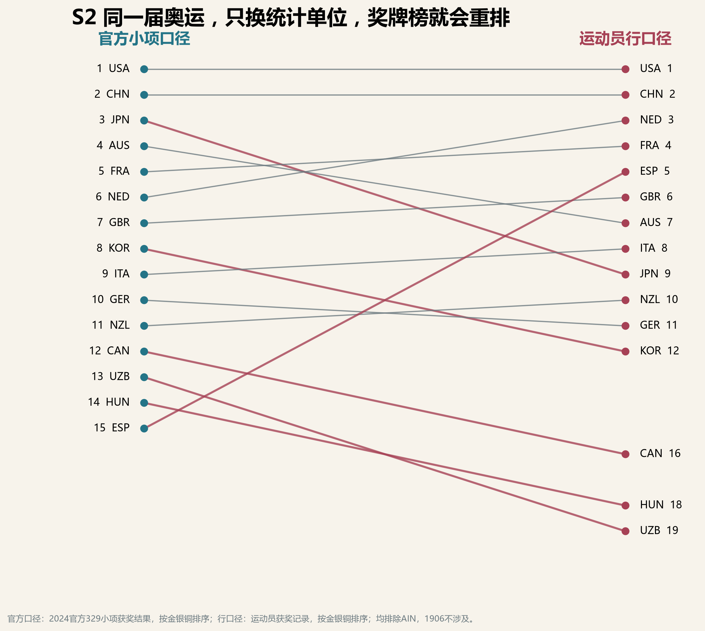
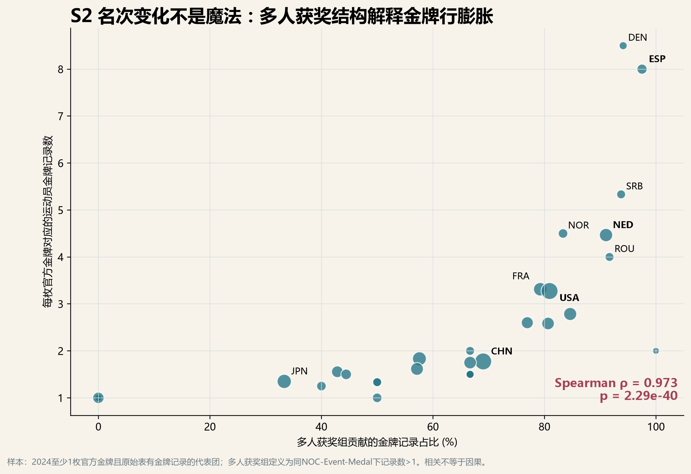
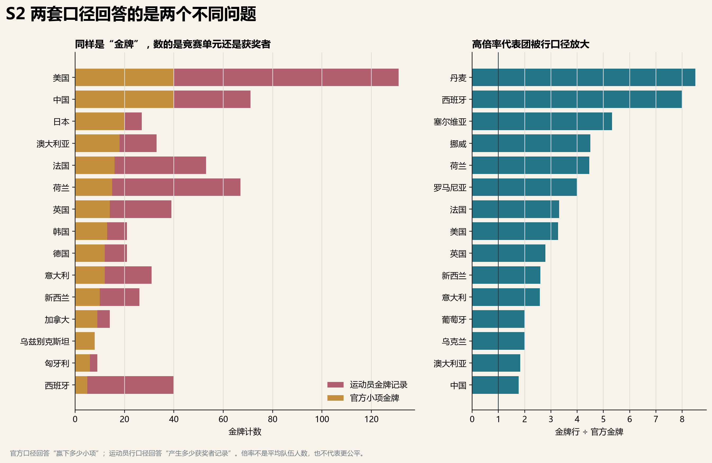
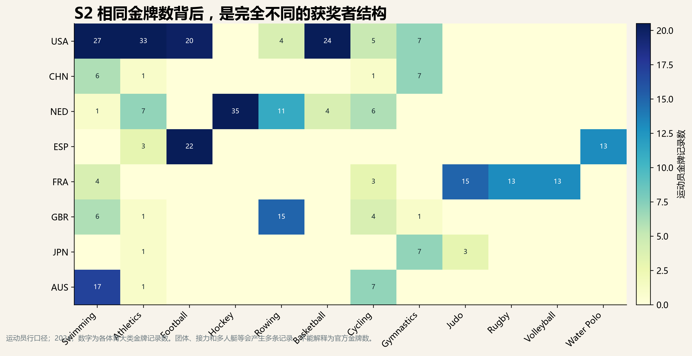
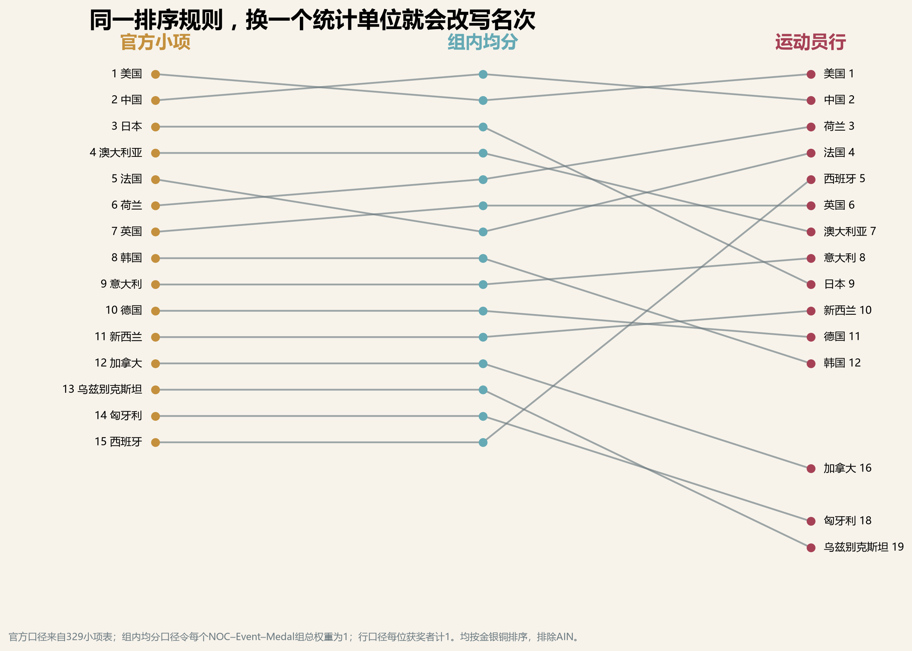
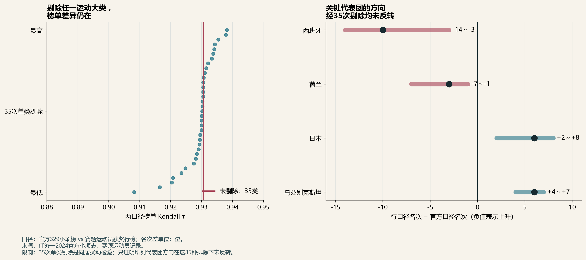
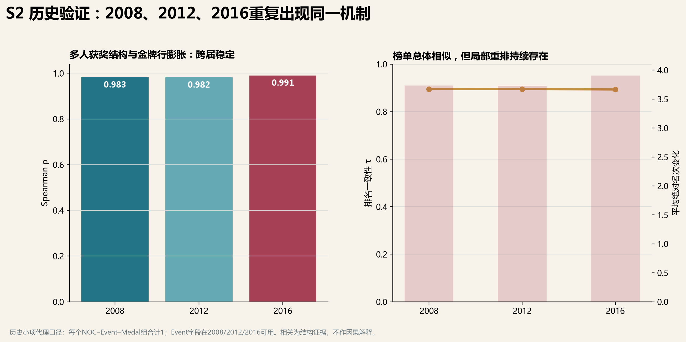

# S2 口径的魔力：奖牌榜究竟在奖励什么？

> 团队：晓组织｜燕山大学｜张子涵（60%）、陈旭（40%）  
> 分析对象：2024巴黎奥运会；官方329小项口径与运动员获奖记录口径。

## 摘要

同一届奥运会，只改变统计单位，奖牌榜就会重排。官方口径把一个获奖小项计为一个竞赛单元；运动员行口径把每一位获奖者计为一条记录。美国和中国均获得40枚官方金牌，但对应131条和71条运动员金牌记录；荷兰以15枚官方金牌位列第6，却以67条金牌记录升至行口径第3；西班牙从官方第15升至行口径第5。进一步分析发现，金牌记录膨胀倍数与多人获奖组贡献占比高度相关，63个有官方金牌且存在原始金牌记录的代表团中，Spearman相关系数达到0.973。所谓“口径魔力”并非统计幻术，而是团体、接力和多人艇等获奖结构被不同统计单位赋予了不同权重。

## 1. 两套口径不是谁对谁错，而是问题不同

官方小项口径回答“一个代表团赢下多少竞赛单元”。例如一支曲棍球队夺冠，不论报名和获奖成员多少，都在官方榜上贡献一枚金牌。运动员行口径回答“产生多少获奖者记录”：同一支队伍的每名获奖成员都会形成一条金牌记录。前者强调竞技项目结果，后者强调奖牌覆盖到多少运动员。离开研究问题讨论哪一种“更公平”没有意义；真正需要防止的是把其中一种口径的数值冒充另一种。

本专题的官方口径不再使用早期草稿中的二手网页，而是直接使用任务一整理的2024官方329小项获奖结果。金、银、铜获奖国家代码按 ` | ` 拆分，从而保留柔道、拳击等项目的双铜牌以及一例并列银牌。运动员行口径来自任务一归一数据，保留经审计的原始重复候选。两种榜单均按金、银、铜依次排序，并排除不参与正式代表团排名的AIN，以避免把“排名规则变化”和“统计单位变化”混为一谈。

## 2. 同一届奥运，奖牌榜发生结构性重排

美国与中国在两种口径中仍居前两位，但相同名次掩盖了不同的内部结构：两国官方金牌同为40枚，美国依靠银牌优势在完整官方榜位列第1，中国第2；转换为运动员行后，美国有131条金牌记录，中国为71条。荷兰从官方第6升至行口径第3，西班牙从第15跃升至第5；相反，日本由第3降至第9，乌兹别克斯坦由第13降至第19。丹麦虽然官方榜仅第29，但凭17条金牌记录升至行口径第14。换言之，行口径会系统性奖励多人项目表现突出的代表团，而更偏个人项目的代表团相对后移。

**方法说明。** 官方榜使用2024官方329小项结果，运动员榜使用2024运动员获奖记录；两者均按金、银、铜依次排序，排除AIN。坡度图左侧选取官方榜前15名，右侧保留这些代表团在行口径完整榜中的实际名次，不把跌出前15者截断。

## 3. 为什么重排：多人获奖结构改变了计数权重

为描述多人获奖结构，本专题定义“多人获奖组”：在同一 `NOC–Event–Medal` 组合下出现两条以上运动员记录。对63个至少获得一枚官方金牌且原始表存在金牌记录的代表团，计算多人获奖组贡献的金牌记录占比，以及“运动员金牌记录数 ÷ 官方金牌数”的膨胀倍数。两者的Spearman相关系数为0.973。两项指标共用金牌行数作为构造元素，因此这一高相关是结构描述，不是独立验证；p值不作为机制成立的额外证据。

西班牙5枚官方金牌对应40条金牌记录，倍率为8.0，其中97.5%的金牌记录来自多人获奖组；荷兰15枚官方金牌对应67条记录，倍率4.47，多人组占91.0%；美国40枚金牌对应131条记录，倍率3.28，多人组占80.9%。中国40枚金牌对应71条记录，倍率1.78，多人组占69.0%。两种计数的差异来自获奖组人数和项目组合，不能解释为“参加团体项目必然提升竞技实力”。是否由单一运动大类驱动，另用2024逐大类剔除试验检验。

**方法说明。** 横轴是多人获奖组金牌记录占全部金牌记录的比例；纵轴是每枚官方金牌对应的运动员金牌记录数；点面积与官方金牌数近似相关。相关检验使用Spearman秩相关，以降低极端倍率和非线性关系的影响。

## 4. 同样是40金，美中讲述的是两种冠军结构

官方口径下美国和中国都是40金，但美国的运动员金牌记录接近中国的1.85倍。这不能解释为美国“真正有131枚金牌”，而意味着美国的冠军更多分布在接力、团体和多人艇等会同时产生多名获奖者的项目中。中国则在跳水、射击、举重、乒乓球等个人或较小团队项目上具有更高权重。西班牙、丹麦、塞尔维亚、挪威等代表团的官方金牌不多，却因为足球、手球、水球、曲棍球或多人项目形成较高的运动员记录倍率。

右侧倍率榜也揭示了为什么不能把“金牌行 ÷ 官方金牌”直接叫作平均队伍人数：同一代表团的金牌组合同时包含个人、双人、接力和完整团队；原始名单还可能包括替补、并列和数据记录差异。它只能被准确称为“每枚官方金牌对应的运动员金牌记录数”。

## 5. 项目结构决定谁被放大

项目热力图提供了机制层面的证据。荷兰67条金牌记录中，曲棍球贡献35条、赛艇11条；西班牙的足球贡献22条、水球贡献13条；法国在柔道、橄榄球和排球形成大量记录；美国在田径、游泳、篮球和赛艇中产生大规模获奖者记录。相反，中国的记录结构更分散，单一完整大团队项目对总数的放大作用较弱。因此，行口径并不是简单地“偏爱体育强国”，而是偏爱那些在多人项目上夺冠的代表团。

**方法说明。** 热力图统计各体育大类的运动员金牌记录数，不是官方金牌数。列出2024年金牌记录规模和官方排名具有代表性的八个代表团，并展示合计记录最多的12个体育大类。

## 6. 公平性讨论：三种合理答案

如果问题是“谁赢下最多小项”，官方小项口径最公平，因为每个竞赛单元权重相等；如果问题是“冠军覆盖多少运动员”，运动员行口径更合适，因为团队中的每名获奖者都被看见；如果问题是“如何同时尊重项目结果和团队成员”，可以使用分数化口径——每个获奖小项总权重为1，再在该队运动员之间均分。分数化口径在总量上接近官方口径，却允许研究成员分布。

因此，本专题不提出一张“终极公平榜”，而是提出一条更重要的原则：先说清问题，再选择统计单位。没有口径说明的奖牌榜不是中立事实，而是隐藏了价值权重的排名系统。

## 7. 结论

2024巴黎奥运会的双口径比较推翻了“奖牌榜只是客观计数”的直觉。同一组比赛结果，在竞赛单元和获奖者两种统计单位下会形成不同秩序。荷兰、西班牙和丹麦的跃升，以及日本、乌兹别克斯坦的相对后移，都可以由多人获奖结构解释。2024逐运动大类剔除试验显示，关键代表团的重排方向并非由单一大类决定。

本专题的贡献不在于宣布哪张榜更真实，而在于揭示每张榜都在奖励什么：官方榜奖励赢下的小项，运动员行榜奖励被奖牌覆盖的个体。真正严谨的可视化，应当把这种隐藏权重放到画面中央。

## 数据来源与边界

- 官方小项结果：任务一《2024官方329小项奖牌表》，含329项结果及Olympics.com结果链接。
- 运动员记录：任务一归一数据集，2024年2,281条奖牌记录。
- 官方结果中包含329个金牌竞赛单元、330个银牌单元和385个铜牌单元；银铜超过329来自并列与双铜牌制度。
- AIN不进入正式代表团排名；其运动员成绩没有被删除，只是不参与本专题榜单排序。
- 多人获奖组依据原始 `Event` 与NOC分组，是结构识别指标，不等于正式团体项目分类。
- 1906不涉及本专题，但全项目继续沿用任务一排除1906的总口径。
# 升级结论：三口径与证据独立的2024稳健性检验

在官方小项口径和运动员行口径之间，本研究新增“团队内均分口径”：对同一 `NOC–Event–Medal` 获奖组，每名运动员获得 `1/组内人数` 的奖牌份额，因此每个获奖组总和严格为1。它保留运动员记录，同时避免团队人数机械放大奖牌。

为了让核心结论不依赖尚未逐项核实的历史奖牌，本研究只用2024年**官方329小项结果**和同届运动员获奖记录做一次敏感性检验：每次剔除一个运动大类，重新计算两套完整榜单，共进行35次。完整数据的两榜 Kendall τ 为 **0.931**；35次剔除后为 **0.908—0.938**，均保留榜单差异。官方前20名代表团的平均绝对名次差，在完整数据中为 **3.45位**，剔除试验范围为 **2.75—4.55位**。

西班牙、荷兰在35次试验中始终因行口径上升，日本、乌兹别克斯坦始终相对后移。这是“不是由某一大类单独造成”的有限稳健性证据；不证明更换全部项目、赛制或届次后仍成立。复算数据见[逐大类剔除表](../02_数据表/S2_2024逐大类剔除敏感性.csv)和[代表团区间表](../02_数据表/S2_2024代表团剔除敏感性.csv)，代码见 `项目工作区/scripts/s2_2024_official_leave_one_sport_out.py`。

## 历史三届的定位

2008、2012、2016的跨届图仅作为**运动员行数据内部口径的探索性复现**。其小项单元来自 `NOC–Event–Medal` 代理，仍有555项缺现行一手逐项核验；因此不再用三届相关或排名系数证明“现行官方奖牌榜跨届稳定”。两项指标还共享多人组/金牌行信息，不能当作独立机制验证。

历史三届分别得到302、302、306个小项代理，外部核验等级见[910项来源覆盖总表](../08_逐项外部核验/历史910项来源覆盖总表.csv)。仅绑定IOC届次入口不算逐项核验。**本专题正式结论以2024官方小项与同届运动员记录为准**；历史图保留为问题发现与未来复核路线，不承担2024结论的证据责任。
