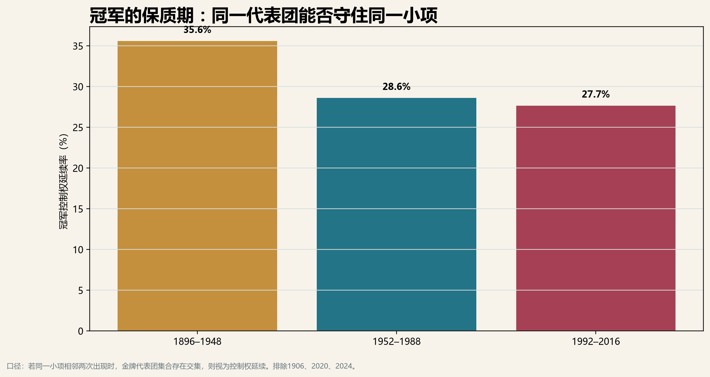
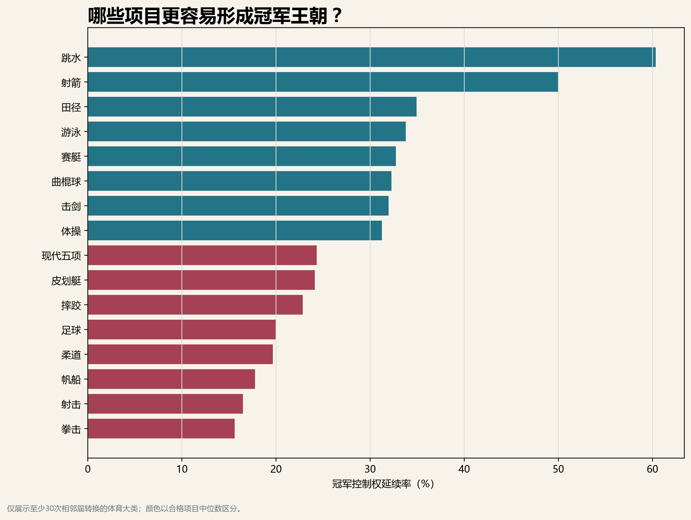
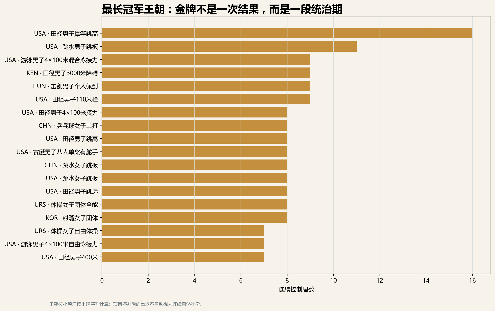

# S3｜冠军的保质期

## 核心问题

一个国家赢得金牌之后，下一次还能守住同一小项吗？本专题把奖牌史改写成“控制权转移史”，测量冠军优势的寿命，而不是累计奖牌总数。

## 主要发现

1896—2016年可比范围内，共识别 **615** 个小项身份和 **4,511** 次相邻届控制权转换。总体控制权延续率为 **29.5%**。最长连续王朝达到 **16届**。不同体育大类的卫冕结构差异显著，说明“体育强国”并不是统一能力，而是一组寿命不同的项目优势。

## 口径与边界

- 研究单位为 `Sport + Event`；同一小项相邻两次出现时，金牌NOC集合存在交集即视为控制权延续。
- 排除非正式的1906届；2020年Event泛化、2024年与历史命名体系不同，因此不进入纵向主分析。
- 小项停办后重返时，比较的是“相邻出现”，不是自然四年周期。
- 并列金牌以集合处理，不强行指定唯一冠军。

## 固定小项队列检验

[查看完整固定队列分析](../09_固定小项队列检验/index.html)。1960—2016年每届连续且名称稳定的113个小项中，1964—1976与1996—2016的代表团卫冕率为34.5%与27.1%，差值-7.37个百分点；按小项成组重抽样95%区间[-13.20, -1.62]个百分点。结果描述代表团小项控制权，不代表个人冠军生涯或严格因果效果。

<!-- DYNASTY_SOURCE_START -->
## 2026-11-17：冠军延续来源敏感性复算

同113项替换二次来源后仍下降7.37个百分点（成组95%区间−13.20至−1.62）；排除涉及未决项的完整系列后剩50项，下降7.33个百分点，但区间−16.17至+1.50跨零，不能声称排除检验也确认下降。原代理同50项结果相同，应区分来源更正与样本选择。二次来源与排除子集均不等于现行IOC认证，未证明竞争加剧的因果机制。

完整结果见S3“11_历史来源敏感性/冠军延续来源敏感性说明.md”，脚本为 `项目工作区/scripts/dynasty_source_sensitivity.py`。本轮仅复算冠军延续，主场与预测尚未进行本轮同类重估。
<!-- DYNASTY_SOURCE_END -->
