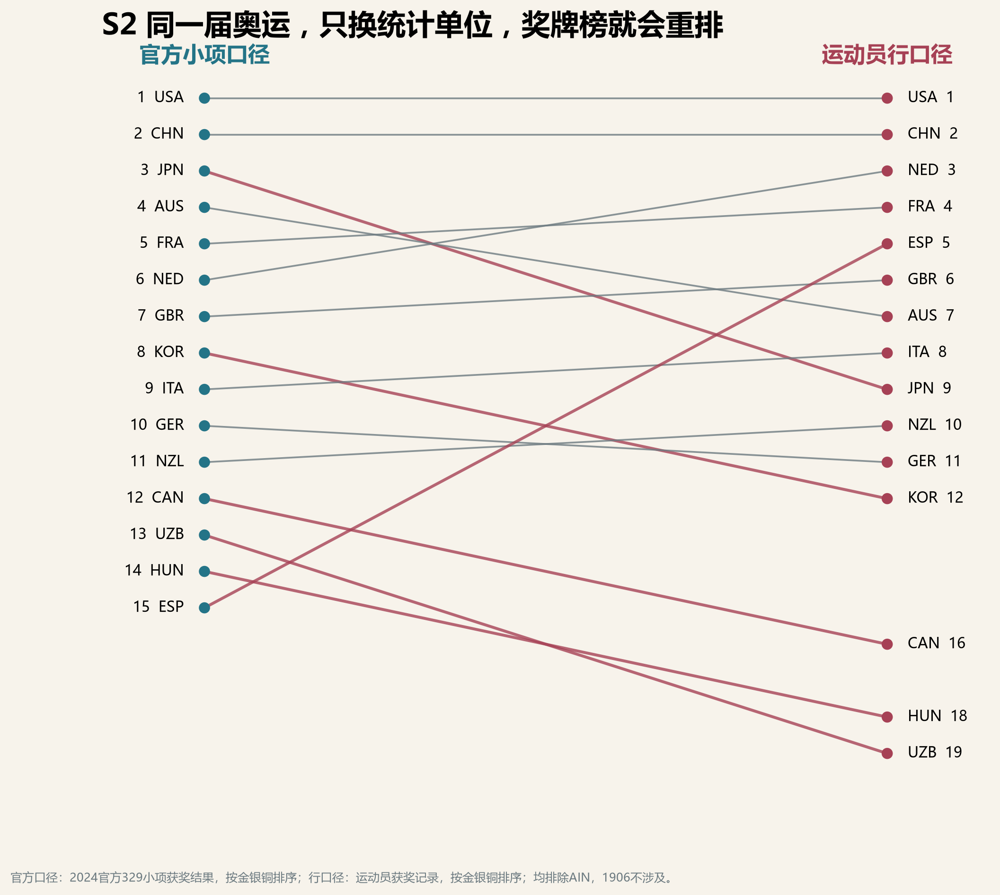
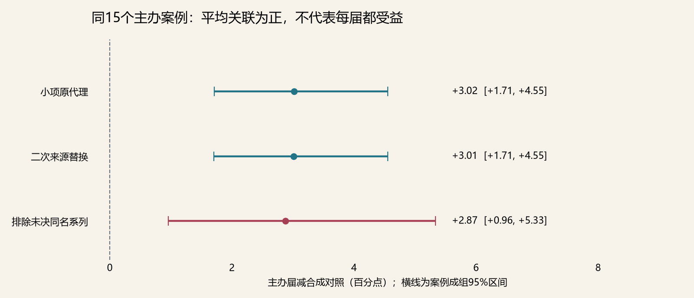
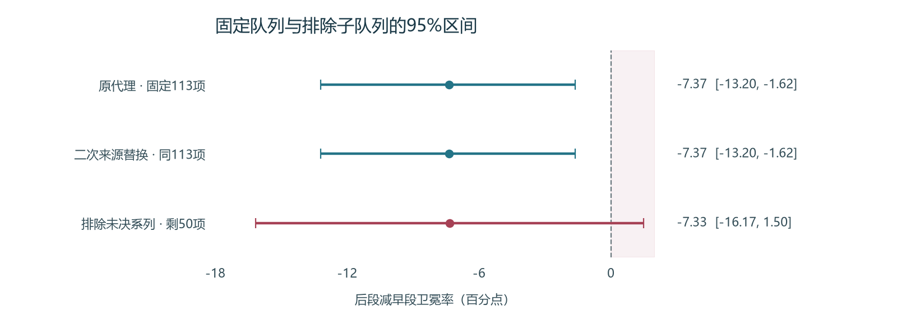

# 三篇旗舰专题：让结论经过反例，再接受检验

这三篇承担主论证，其余七篇作为扩展探索。选取依据是问题清晰、存在能反驳直觉的案例、具有替代口径或比较设计、可追溯到逐项表；不是按画面复杂度选择。以下对照使用项目已交付的结果表，来源核验范围见各节。

## 一、口径的魔力：排名变化来自实力，还是统计单位？

**原判断。** 同一届比赛应该只有一张可直接比较的奖牌榜。

**反例。** 巴黎2024西班牙在官方奖牌榜第15，在运动员金牌行榜第5。这个差异不表示IOC改判或多发金牌，而是同一团队获金后产生多名获奖成员记录。

**比较设计。** 固定届次、代表团与金牌颜色，分别计算官方小项、团队内均分和运动员行。还要区分排名规则变化与计数单位变化：官方金银铜依次比较和仅按金牌数的并列规则并不相同。不能把全部名次差都归因于团队规模。

**机制检验。** 逐大类剔除表的完整口径含329小项、2275条匹配获奖行，前20代表团平均绝对名次移动3.45位；这里是匹配样本，不是原表全部2281条获奖行。剔除运动大类后继续重排，检查结果是否只由某一个团体运动推动。各口径必须使用同一名次规则和共同样本。

### 同一排序规则下，西班牙的金牌记录如何增加

两榜都按金、银、铜依次比较。西班牙的 5 枚小项金牌对应 40 条运动员金牌记录，其中足球和水球贡献 35 条，占新增 35 条记录中的 33 条。名次变化由全部代表团重新排序产生，表中的差额可以按运动相加。

| 运动 | 小项金牌 | 运动员金牌记录 | 记录差额 |
| --- | ---: | ---: | ---: |
| 足球 | 1 | 22 | +21 |
| 水球 | 1 | 13 | +12 |
| 田径 | 2 | 3 | +1 |
| 帆船 | 1 | 2 | +1 |
| 合计 | 5 | 40 | +35 |

[查看西班牙拆解、原始数据与完整排名](S2_口径的魔力/西班牙双口径案例.html) · [在实验室试剔除足球](S2_口径的魔力/09_奖牌口径实验室/index.html?exclude=Football#sport-removal) · [下载按运动构成表](S2_口径的魔力/02_数据表/S2_西班牙金牌构成.csv)

**反证条件。** 如果统一排名规则或剔除某类运动后重排消失，就应缩小“普遍口径效应”的主张；如果均分结果与官方不合，先查成员匹配与并列奖牌，不能把均分当作天然正确答案。

**修正结论。** 统计单位改变了团队成员获得的权重，因此改变榜单回答的问题；不宜宣称其中一张是唯一公平榜。两处协会结果错误作为“权威接口也需要交叉核对”的独立案例，不能拿来证明所有协会数据都不可靠。

证据：[排名规则与单位分解](../任务一_数据体检/04_质量检查结果/2024双口径敏感性.csv)；[逐大类剔除](S2_口径的魔力/02_数据表/S2_2024逐大类剔除敏感性.csv)；[外部核验材料](S2_口径的魔力/08_逐项外部核验/)。

## 二、主场效应：自身下降，也可能优于比较组

**原判断。** 东道主成绩比上届高，就证明主场带来净收益；比上届低，就没有主场优势。

**反例。** 巴西2016获奖记录份额比前届低0.57个百分点，但相对前届份额相近比较组的差值为正0.13个百分点。前后比较与相对比较可以方向相反。

**比较设计。** 先做九例描述，再以匹配比较和合成对照引入反事实参照。扩展合成对照从1948—2024的20个候选主办届次中得到17个可用案例，其中14个赛前拟合较好；报告筛选和拟合标准，不能只选效果最大的案例。

**交叉证据。** 17例平均差值为+3.37个百分点；14个高拟合案例为+2.24个百分点，案例自助法区间约[1.30,3.28]。排除1956及抵制相关届次后为+2.52个百分点。17例逐例排除范围约[2.78,3.60]，这个范围与14例估计不是同一总体，不能混用。

### 巴西 2016 在哪些比较下是正值

| 比较方式 | 份额差（百分点） |
| --- | ---: |
| 运动员获奖行 · 比自己上届 | −0.57 |
| 运动员获奖行 · 比五队匹配组的变化 | +0.13 |
| 小项代理 · 合成对照，原来源 | −0.11 |
| 小项代理 · 合成对照，替换二次来源 | −0.17 |
| 小项代理 · 合成对照，剔除未决同名系列 | −1.22 |

正值仅出现在此处列出的五队匹配比较。切换到小项合成对照时，统计单位和比较设计同时变化，两者的影响无法单独识别。剔除同名系列还改变了样本构成。

[查看主场敏感性主图与对照权重](S1_东道主效应/01_来源与口径敏感性/index.html) · [下载逐主办案例](S1_东道主效应/01_来源与口径敏感性/三方案逐主办案例.csv)

**反证条件。** 若预趋势不平行、主办前已有投资跃升，或更换比较组后差值逆转，就应把“主场净收益”降为关联性解释。自助法区间只量化给定设计下波动，不消除主办权选择偏差。

**修正结论。** 多种设计支持样本中的主办届相对优势，但无法区分观众支持、投入、项目设置与资格扩张的独立因果贡献。预测中只采用收缩情景，不把研究差值直接当作确定加成。

证据：[合成对照摘要](../任务二_百年全景/02_数据表/B_扩展合成对照摘要.json)；[匹配DID逐案例](../任务二_百年全景/02_数据表/B_匹配DID逐案例.csv)。

## 三、冠军延续：项目表变化能否解释王朝变短？

**原判断。** 后期卫冕率下降，意味着冠军个人变弱，或新设小项使统计出现假象。

**关键识别。** 这里的冠军是代表团对小项金牌的连续控制，不是个人运动员。先固定1960—2016每届连续且名称稳定的113个小项，形成1582次控制权转移，减少新设、退出和明显改名的组成影响。

**交叉证据。** 固定队列早段1964—1976卫冕率34.51%，后段1996—2016为27.14%，下降7.37个百分点；以小项为组的自助法95%区间约[-13.20,-1.62]个百分点。逐运动排除后的变化范围约[-8.65,-3.54]个百分点，方向未逆转。主比较避开抵制集中的中间时期，但这不消除所有政治与资格影响。

### 113 项和 50 项放在同一尺度比较

| 队列 | 控制权转移 | 早段卫冕率 | 后段卫冕率 | 变化（百分点） | 成组 95% 区间（百分点） |
| --- | ---: | ---: | ---: | ---: | --- |
| 固定 113 项，替换二次来源 | 1,582 | 34.51% | 27.14% | −7.37 | [−13.20, −1.62] |
| 排除相关完整系列，剩余 50 项 | 700 | 39.00% | 31.67% | −7.33 | [−16.17, +1.50] |

同一批 113 项换用二次来源，结果与原代理一致。同一批 50 项用原代理计算，结果也与排除方案一致。两批队列的点估计接近，但 50 项的区间包含零。在该子集上，证据仍容许卫冕率无变化或小幅上升。

[查看冠军延续敏感性主图与复算方法](S3_冠军的保质期/11_历史来源敏感性/index.html) · [下载固定队列复算表](S3_冠军的保质期/11_历史来源敏感性/固定队列三方案复算.csv)

**反证条件。** 若把历史身份连续性、同名小项实质规则变化或入样条件改写后下降消失，结论必须降级。连续举办小项的选择偏差仍在，不能外推到全部新兴运动。

**修正结论。** 在这个固定历史代理队列中，代表团延续冠军控制的频率下降；不能归因于个人实力下降，也尚不能唯一归因于竞争全球化。连续段存在右删失，长度分布不能直接当作严格生存函数。

证据：[固定队列摘要](S3_冠军的保质期/09_固定小项队列检验/固定小项检验摘要.json)；[逐小项前后段](S3_冠军的保质期/09_固定小项队列检验/固定小项前后段卫冕率.csv)；[逐运动排除](S3_冠军的保质期/09_固定小项队列检验/逐运动排除敏感度.csv)。

## 三篇如何串成一条研究线

先确认“在数什么”（口径），再比较“相对谁变好了”（主场），最后检验“观察到的变化是否只是样本组成改变”（冠军延续）。创新点是可反驳、可修正的分析流程，而不是额外添加三个复杂模型。

历史910项已建立分层证据；原剩余555项完成独立二次来源对照，不等于现行IOC逐项确认。三篇都保留原有证据等级，不通过叙事包装提高来源等级。

## 2026-11-17｜历史证据的三方案复算

主证据优先引用已核验巴黎2024；历史三届作为附来源版本的对照。对555项采用原代理、二次来源替换、排除未决项三方案，31小项/64奖牌字段不同，2008和2012金牌数名次分别影响11、26队，2016金牌数名次未变。排除仅剩355项，运动构成改变，不是官方全届榜。本轮没有重新训练预测或复算主场、冠军延续模型，不能泛化为全作品稳健性证明。详见 `S2_口径的魔力/08_逐项外部核验/未决证据三方案敏感性/未决证据影响报告.md`。

<!-- DYNASTY_SOURCE_START -->
## 2026-11-17：冠军延续来源敏感性复算

同113项替换二次来源后仍下降7.37个百分点（成组95%区间−13.20至−1.62）；排除涉及未决项的完整系列后剩50项，下降7.33个百分点，但区间−16.17至+1.50跨零，不能声称排除检验也确认下降。原代理同50项结果相同，应区分来源更正与样本选择。二次来源与排除子集均不等于现行IOC认证，未证明竞争加剧的因果机制。

完整结果见S3“11_历史来源敏感性/冠军延续来源敏感性说明.md”，脚本为 `项目工作区/scripts/dynasty_source_sensitivity.py`。本轮仅复算冠军延续，主场与预测尚未进行本轮同类重估。
<!-- DYNASTY_SOURCE_END -->

<!-- HOST_SOURCE_START -->
## 2026-11-17：主场来源与口径敏感性

15个共同历史主办案例中，小项原代理平均差值为+3.02个百分点，二次来源替换后为+3.01；排除未决同名系列后为+2.87。对应成组95%区间均在零以上。这是样本内关联，不能证明主办的因果收益。

巴西2016：原“五队匹配、运动员行”比较为+0.13个百分点；小项合成对照原代理为−0.11，替换后为−0.17，排除后为−1.22。统计单位与比较方法同时变化，不能拆分归因；“巴西仍有相对优势”仅适用于原来的特定比较。英国2012在排除情景也由正转负，不能以平均值替每个案例背书。

原运动员行合成对照17个案例已逐例复现，最大误差小于0.00001个百分点。另建1948—2016的小项代理，三方案共同15案；原模型17案与新模型15案不可直接作增减比较。555项记录不包含个人名单，因此没有据此重分配运动员奖牌。

B仅替换555项的奖牌代表团；C在所有历史年份剔除相关209条同名小项系列，运动构成明显改变，不能称为纠偏后的真值。各案例固定原小项情景的对照池，分别重拟合权重；参赛行特征保持不变。小项代理同NOC同色多枚可能合并，二次来源及剩余子集均非现行IOC逐项认证。图中区间按主办案例重抽样；另按13个主办代表团整簇重抽样，三方案区间也均为正（详见CSV）。两者均不消除选择、抵制、身份与规则混杂。

数据与方法：S1_东道主效应/01_来源与口径敏感性；复现脚本 `host_source_sensitivity.py`，页面集成与补充PDF脚本 `integrate_host_sensitivity.py`。2028尚未在本轮重训。
<!-- HOST_SOURCE_END -->
