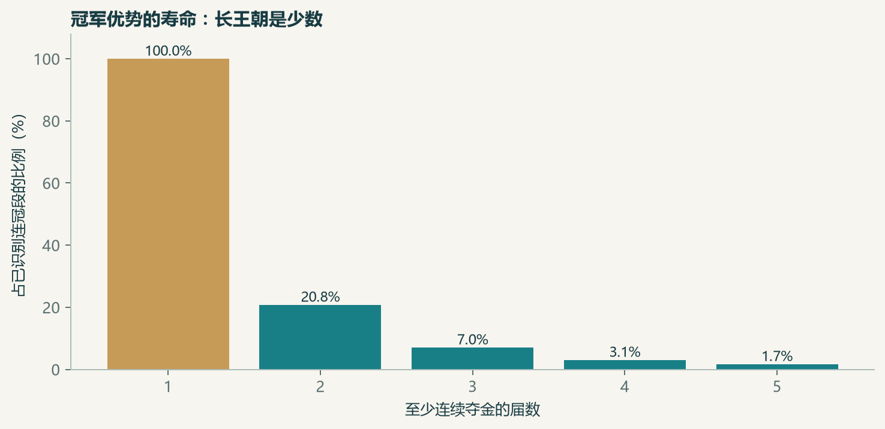
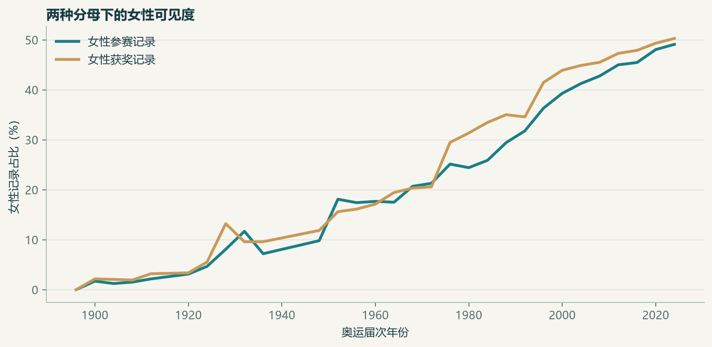
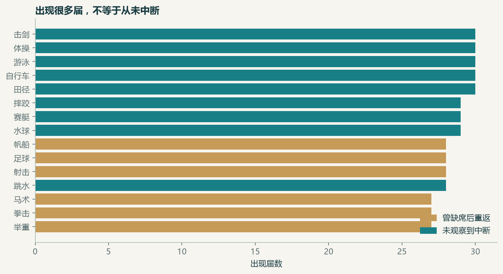
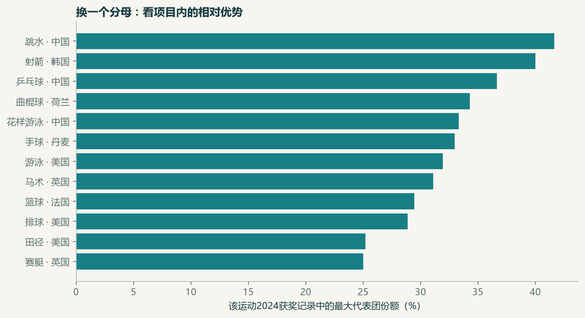

# 自拟专题深度复核：四个问题，四种统计陷阱

**晓组织｜燕山大学｜2026 年 11 月。** 本补充报告把任务三的 S7—S10 从展示型故事推进到可复算的机制分析。所有数字由 `项目工作区/scripts/custom_topics_deep_audit.py` 从任务一归一表重算；主分析排除 1906，保留历史代表团身份。自拟专题正式参赛资格仍以主办方备案要求为准。

## S7 冠军的保质期：长期统治到底有多少？

已有专题按同一小项相邻两次出现时，金牌代表团集合是否有交集，识别 **4,511 次**控制权转换；其中 **29.55%** 保持原代表团。这个数字说明“守住”比“夺得”难，但并不自动说明冠军优势随时间呈恒定风险。新增的王朝长度分布以 **3,833 个已识别连续夺冠段**为分母，只有 **20.79%** 至少延续两届。它把极长王朝放回总体分布：最长连续 16 届确实醒目，却不能代表多数小项的常态。

**机制与反例。** 一个项目在多个相邻届次连续出现，才有更多机会形成长王朝；小项停办后重返、参赛资格变化和历史代表团更名都会改变“守住”的难度。原有分析把小项相邻两次出现作为可比边界，而不是机械要求每隔四年举办。若 2016 年仍在连续夺冠，后续是否终结在主分析中不可见，因此寿命分布的末端存在**右删失**；本图是已观察到的连续段分布，不是严格估计的生存函数。图中 29.55% 是相邻小项控制权延续率，20.79% 是连冠段长度比例，分母不同，不应相减或互称。数据见 [王朝长度分布](S3_冠军的保质期/08_深度复核/S7_王朝长度分布.csv) 与原专题的逐小项转移表。

## S8 她们登上领奖台：两个分母给出什么不同答案？

女性获奖运动员记录占比从 1896 年 0% 升至 2024 年 **50.28%**；同届女性参赛记录占比为 **49.10%**，两者相差 **1.185 个百分点**。新增双曲线让评委直接检查两条路径，而不把“获奖超过半数”单独作为平权结论。2024 年若只看赛事设置，女子专属小项占官方 329 项的约 45.9%；参赛、获奖、小项依旧是三个不同统计单位。

**交叉验证与反例。** 将 2024 年代表团按女性参赛行占比与女性获奖行占比求差，只纳入**至少 20 条获奖行**的 24 个代表团，减少极小样本的比例抖动。在这个筛选下，印度约为 **−35.1 个百分点**、波兰约为 **−17.8 个百分点**。这些差值不是个人获奖概率：分子、分母都是运动员记录，且团体规模、项目组合和参赛名额不同。它们提示哪里值得按运动家族继续拆解，不能直接评价代表团的性别制度。逐届差值表和 2024 代表团表随专题交付；Sex 字段只有 M/F，无法覆盖更广义的性别身份问题。

## S9 消失的赛场：最后出现，不等于永久退场

归一后的数据中共有 **52 个运动家族**；其中 **15 个**至少经历一次缺席后重返，**17 个**在 2024 年没有出现。两组数字回答的是不同问题：重返是历史中断，2024 缺席仅是观察窗口末端状态。橄榄球、马球、曲棍球与射箭都有不同形式的间断或重返，说明“出现很多届”与“从未中断”不能画等号。

**方法与边界。** 对每个归一运动家族建立 1896—2024 的逐届出现矩阵；一个家族从缺席变为出现，且不是首次出现时，记一次“重返”。运动家族之间的项目范围与正式 IOC 体育项目不总是一一对应；2020 年后原始 Sport 命名漂移、早期项目在夏冬奥之间迁移，也可能改变末端状态。因此 **17 个在 2024 缺席的家族不能写成 17 个“被永久取消的项目”**。最能说明这点的反例是花样滑冰和冰球：它们曾在夏奥记录中出现，如今从夏奥表消失并不等于从整个奥运体系消失。完整生命周期表见[运动家族出现与重返](S9_消失的赛场/08_深度复核/S9_运动家族出现与重返.csv)。

## S10 奖牌藏在哪些项目：换一个分母，优势如何重排？

田径、游泳和赛艇在主分析历史表中合计 **10,947 条获奖运动员记录，占 28.54%**。这描绘的是获奖记录的机会结构，不是三类运动“更重要”。田径和游泳有更多小项与举办届数，赛艇含多人艇；按历史绝对量直接评判某代表团优势，容易同时奖励项目设置、团队人数与参赛年限。

**改用同届项目内份额。** 对 2024 年每个运动家族，计算某代表团获奖行数除以该家族全部获奖行；只展示总获奖行至少 **25 条**的 26 个家族，避免小分母产生极端份额。中国在跳水的 15/36 条对应 **41.7%**，韩国在射箭的 12/30 条对应 **40.0%**，荷兰在曲棍球的 35/102 条对应 **34.3%**。这些数字比“历史大类累计榜”更接近当届项目内相对优势，但曲棍球的团队人数仍会改变行口径份额；若研究官方竞赛单元，应进一步切换到任务一的 2024 官方小项获奖表。完整历史大类表和 2024 项目内最大代表团份额表随专题交付。

## 复现与结论

从项目根目录运行 `py 项目工作区/scripts/custom_topics_deep_audit.py`。脚本读取任务一的归一数据，生成四个专题的 CSV、四幅补充图与 `任务三_专题深挖/自拟专题深度核验摘要.json`。所有图表在图注和上文声明了统计单位，和 S2 的双口径主专题形成同一研究原则：**绝对量、份额、记录行与官方小项不能互相冒充**。

四个专题共同提供一处推翻直觉的结论：**更大的历史总量并不必然意味着更持久的统治、更充分的平权、更稳定的项目地位或更强的单项优势**。四种误读分别来自观察窗口、分母、分类变化和统计单位。图表并不代替因果识别；其价值在于让每项结论都能被数据表复核，并明确下一步需要什么外部证据。
