# 百年奥运全景：扩张、权力转移与结构性平权

> 团队：晓组织｜燕山大学｜张子涵（60%）、陈旭（40%）  
> 范围：1896—2024 年夏季奥运会；1906 年不纳入主分析。

## 0. 研究设计与统一口径

本文回答四个相互关联的问题：奥运规模如何扩张、奖牌权力如何转移、女性平权走到哪一步、比赛项目如何演化。历史主表采用“运动员记录口径”：一名运动员在一个小项中的一条获奖记录计为一条奖牌记录，因此团体项目会产生多条记录；它适合观察参与、项目结构和代表团内部构成，但不能冒充官方奖牌榜。2024 年小项数量与性别属性由任务一整理的官方 329 小项表提供；2020 年原始 Event 字段已泛化，故不用于小项数量趋势。历史政体按原始 NOC 分立，URS、GDR、FRG、GER 不强行拼接。空白优先解释为“无参赛记录”，而非自动补零。

## A. 奖牌结构：规模膨胀，但垄断程度下降

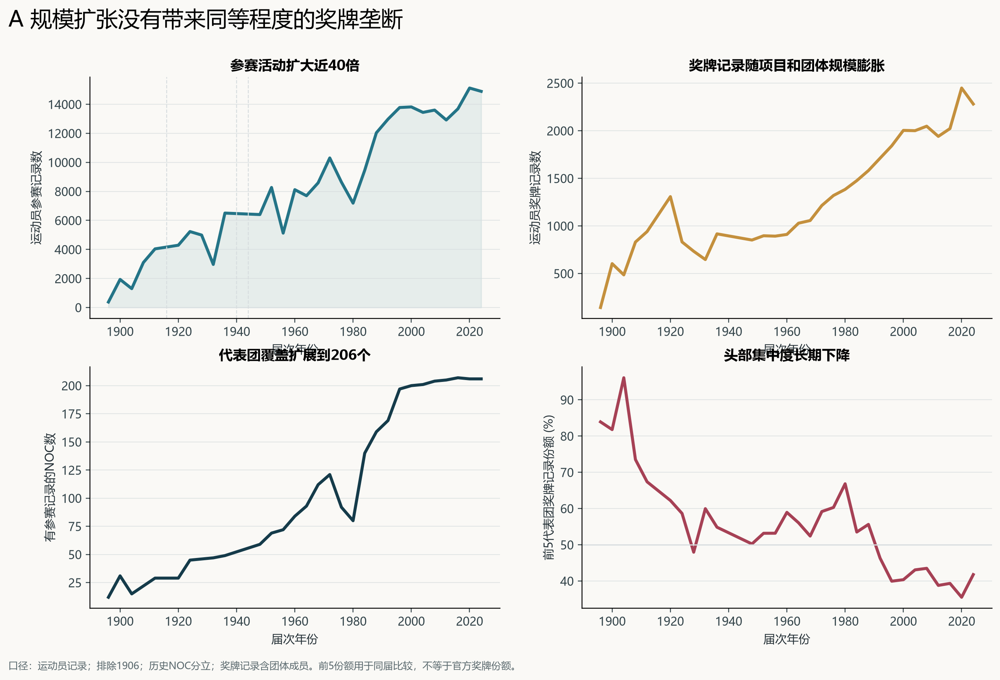

1896 年主表只有 380 条参赛记录、12 个代表团和 143 条运动员奖牌记录；到 2024 年分别增长至 14,892 条、206 个代表团和 2,281 条奖牌记录。与此同时，奖牌记录最多的前五个代表团，其同届份额由 83.9% 降至 41.8%。这组反向变化揭示了奥运百年史的关键结构：项目、参赛者和国家覆盖快速扩张，绝对奖牌记录随之“通胀”，但成果分布并未同步向少数强国集中。今天的强国可能拿到更多绝对奖牌记录，却更难复制早期一国占据半壁江山的垄断。

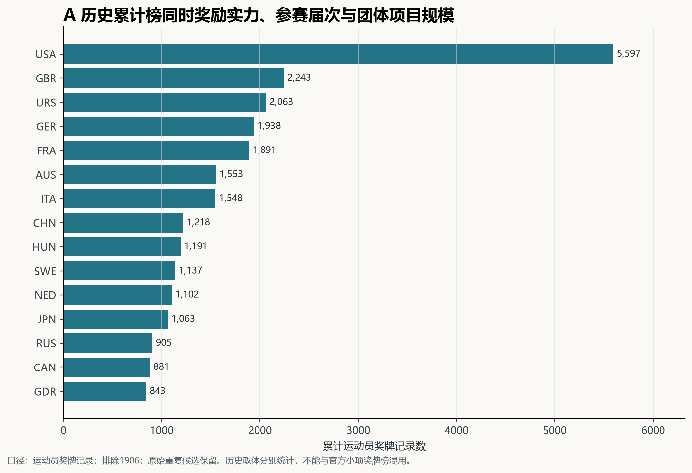

累计榜中 USA 为 5,597 条运动员奖牌记录，显著领先；但该榜同时奖励竞技实力、参赛届次和团体项目规模。它适合描述“历史贡献总量”，不适合直接断言单届统治力，也不能与官方按小项计数的金银铜榜混用。为避免排名幻觉，主结论优先使用同届份额，累计榜只作补充。

**方法说明。** 规模指标按届次聚合；集中度用同届运动员奖牌记录的前五代表团份额衡量。1906 排除，原始重复候选按任务一审计决定保留。该口径对团体项目权重更高，故同时披露绝对值与份额并明确使用边界。

<!-- CONCENTRATION_REPORT_START -->
### A2. 长期去集中化的压力测试

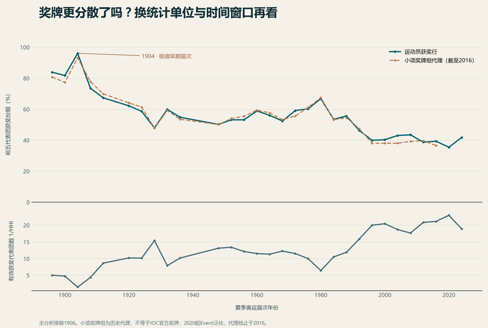

前五代表团获奖行份额的早期届次中位数为 64.8%，1992—2024 为 40.4%；把 2016 年及以前改为同届项目奖牌组代理，两个时期的中位数分别为 67.0% 和 38.1%，长期下降方向仍在。但 2016—2024 的获奖行前五份额从 39.3% 回升至 41.8%，有效获奖代表团数从 21.1 降至 18.9，不能把长期趋势写成“每届持续下降”。历史代理不是 IOC 官方小项表，2020 起 Event 泛化后不再计算。完整分母、反例、逐届数据与复现见[结论压力测试](../07_结论压力测试/结论压力测试.md)。
<!-- CONCENTRATION_REPORT_END -->

## B. 强国兴衰：真正的历史曲线存在断点

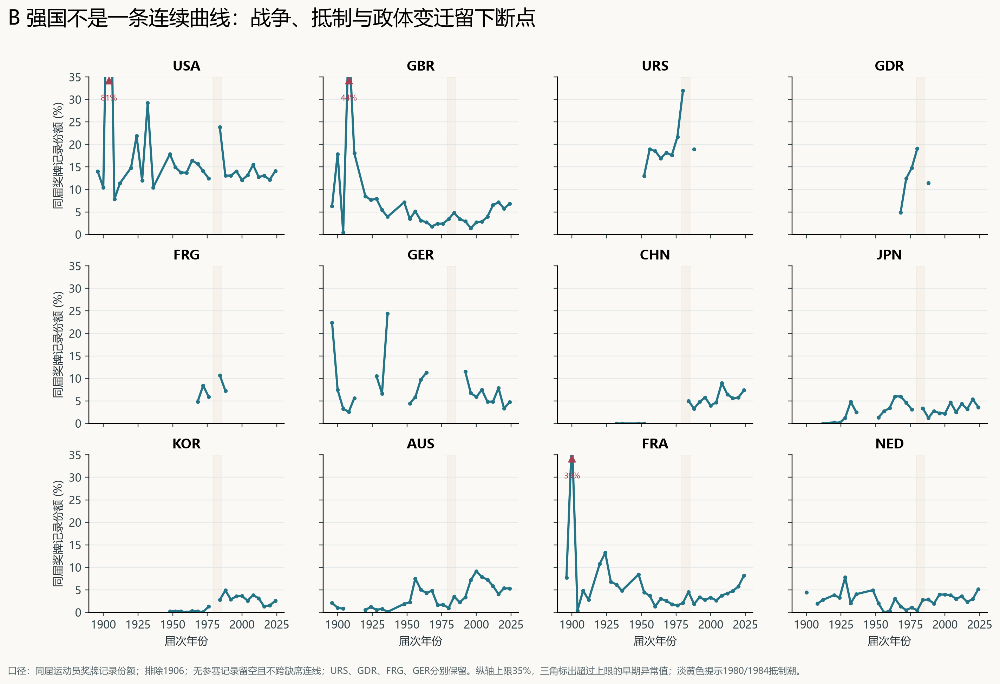

十二个代表团的同届奖牌记录份额显示，强国并不是一条平滑、连续的成长曲线。USA 在 1904 年达到异常高位 81%，但战后多数届次处于约 12%—16%；URS 自 1952 年登场后迅速进入高位，1976 年达到约 21.7%，1988 年仍约 19.0%；GDR 在 1976 年约 14.8%，其短期高峰不能被简单并入今天的 GER。CHN 自 1984 年形成连续轨迹，2008 年约 9.0%，2024 年约 7.4%。这些变化既包含竞技实力，也包含主场效应、项目设置、抵制潮和政体变迁。

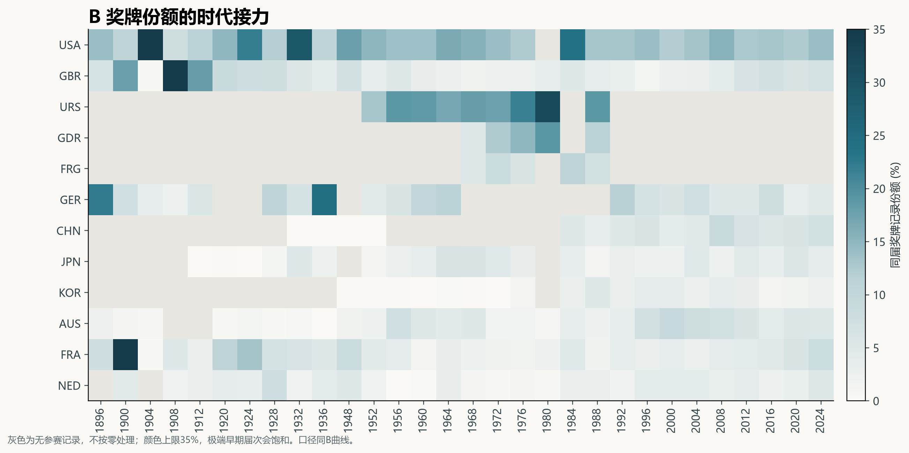

热力图把“时代接力”呈现得更清楚：早期由欧美传统代表团占据高份额，冷战时期出现 URS、GDR 等高强度板块，近几十年则形成更多强队并存的格局。图中的灰色是没有参赛记录，不是零奖牌；1980 与 1984 年抵制潮所在区域也应谨慎解释。真正高质量的历史分析，不应为追求一条漂亮长线而抹去战争、抵制和政体变化造成的断裂。

**方法说明。** 指标为“某 NOC 当届运动员奖牌记录数 ÷ 当届全部运动员奖牌记录数”。无参赛记录留空且不跨缺席年份连线；历史政体分别展示。小多图统一把纵轴限制在 35%，超过上限的早期异常值以三角和数值标出，兼顾现代阶段可读性与极端值披露。

### B2. 主场效应的定量拆解

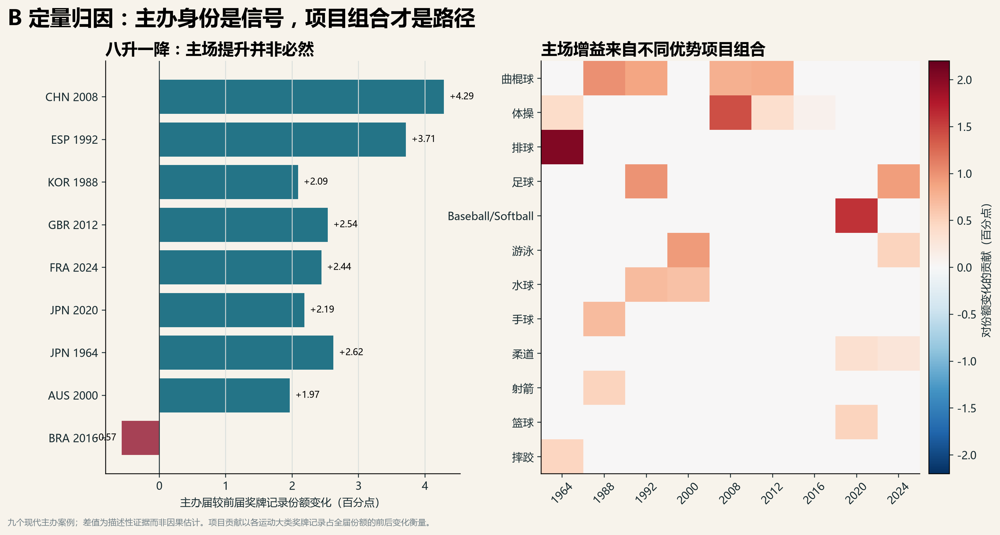

九个现代主办案例中八个在主办届奖牌记录份额上升：中国2008较前届增加4.29个百分点，西班牙1992增加3.71个百分点；巴西2016则下降0.57个百分点。按运动大类进一步分解后可以看到，各国增益依赖不同优势项目组合，说明主办身份更像资源、资格与备战共同作用的信号，而不是自动兑换奖牌的按钮。该比较只作描述性归因，不能称为因果净效应。

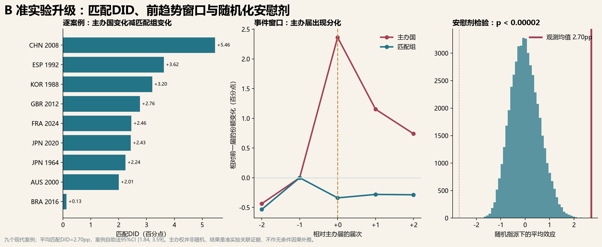

为增强识别可信度，每个主办国按前一届奖牌记录份额匹配五个同期非主办代表团，再计算“主办国前后变化减匹配组同期变化”的差分中的差分。九个案例平均DID为 +2.70 个百分点，案例自助法95%区间为 [1.84, 3.59]；5万次组内随机指派没有产生同等极端的平均效应（经验 `p < 0.00002`）。主办前两个届次的平均趋势差为0.24个百分点，未见明显系统性预趋势。不过主办权并非随机，匹配只使用前届份额，仍可能受到体育投入、资格扩张与政策周期等未观测因素影响，因此结论严格表述为“更强的准实验关联证据”，而非无条件因果效应。

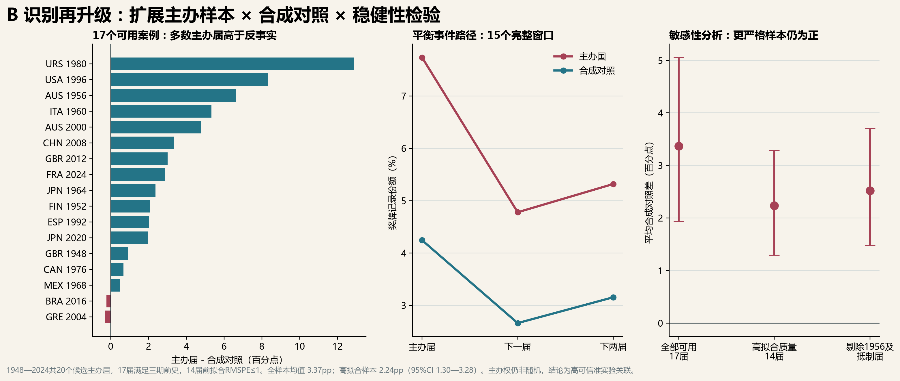

为降低九案例的小样本风险，进一步整理1948—2024年的20个候选主办届，其中17届具备三个主办前届次的连续可比信息，14届达到前拟合RMSPE不超过1的严格阈值。针对每一届，使用前三届奖牌记录份额与参赛记录份额，为非主办代表团估计非负且和为1的合成权重，并排除事件窗口内成为东道主的供体。全体17个可用案例的平均主办届差为 +3.37 个百分点；更可信的14个高拟合案例为 +2.24 个百分点，95%区间为 [1.30, 3.28]。剔除1956双城记录以及1980、1984抵制届后，均值仍为 +2.52 个百分点。留一法结果范围为2.78至3.60个百分点，说明结论并非由单个案例决定；后续路径只使用具有完整两届观察的平衡窗口。该扩展显著提升了稳健性，但仍不能消除主办权选择与提前投入带来的内生性。

## C. 女性参与：人数接近平权，不等于项目结构完全平权

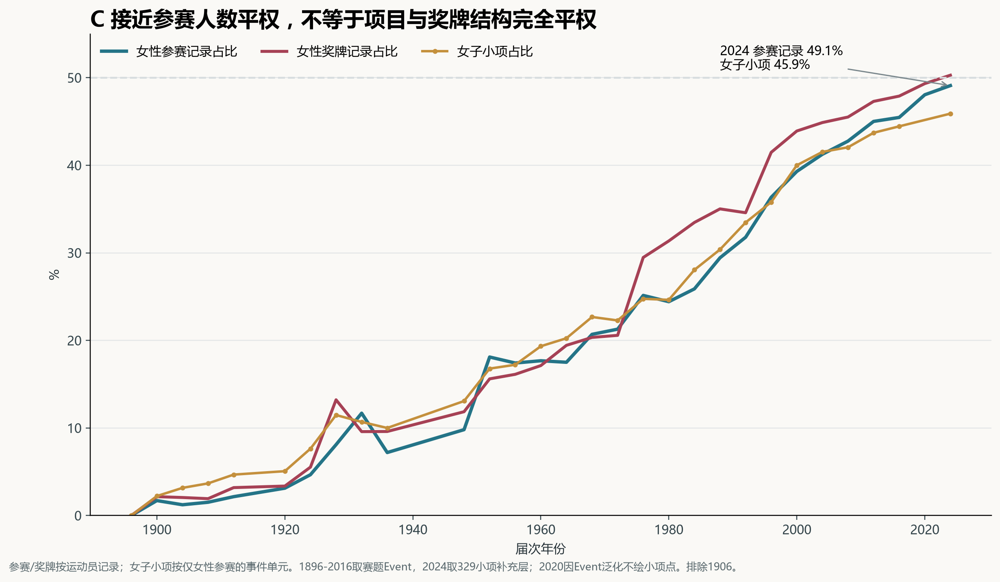

2024 年女性运动员参赛记录占 49.1%，女性奖牌记录占 50.3%，已经非常接近甚至略高于数量平权线；但官方 329 个小项中，女子专属小项为 151 个，占 45.9%。因此，“男女运动员人数接近”不等价于“竞赛机会结构完全对称”：混合小项、团体人数和项目设置会使参赛、获奖、小项三种比例出现差异。把三层指标放在一起，比只报道一个 50% 更能说明平权取得的进展与剩余结构性空间。

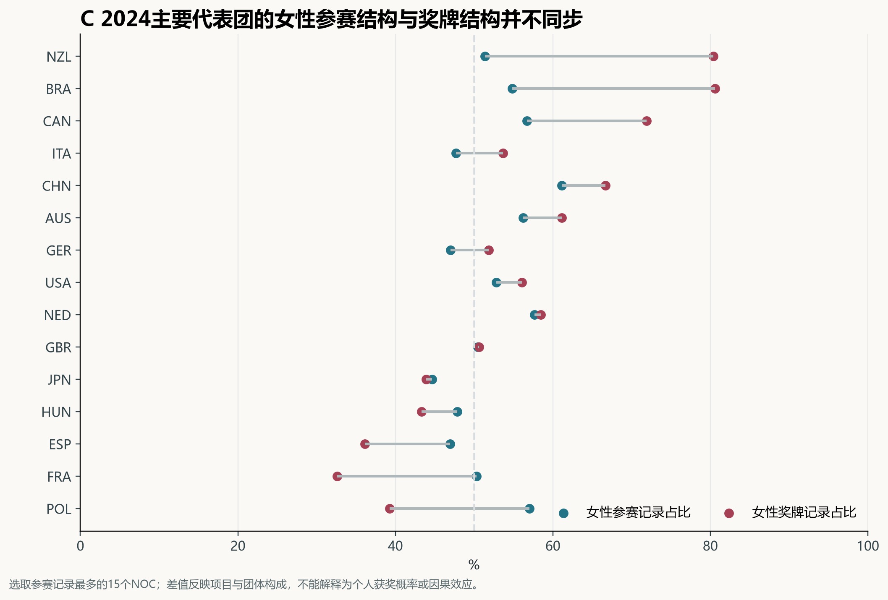

国家内部也存在明显差异。在 2024 年奖牌记录较多的代表团中，NZL 的女性奖牌记录占比比女性参赛记录占比高约 29.0 个百分点，BRA 高约 25.7 个百分点；FRA 和 POL 则分别低约 17.7 个百分点。这个差值不能直接解释成制度优劣，因为项目组合、团体规模和优势项目都会影响结果；它更适合作为“结构偏离”的筛查信号，引导后续按运动大类和小项深入拆解。

**方法说明。** 历史参与和获奖比例按主表 Sex 字段计算；2024 小项性别属性来自官方 329 小项表，女子专属、男子专属和混合项目分开统计。国家比较只展示奖牌记录量较高的代表团，避免小样本比例剧烈波动；差值单位为百分点，不是增长率。

<!-- GENDER_DECOMP_START -->
### C2. 50.3% 从哪里来？

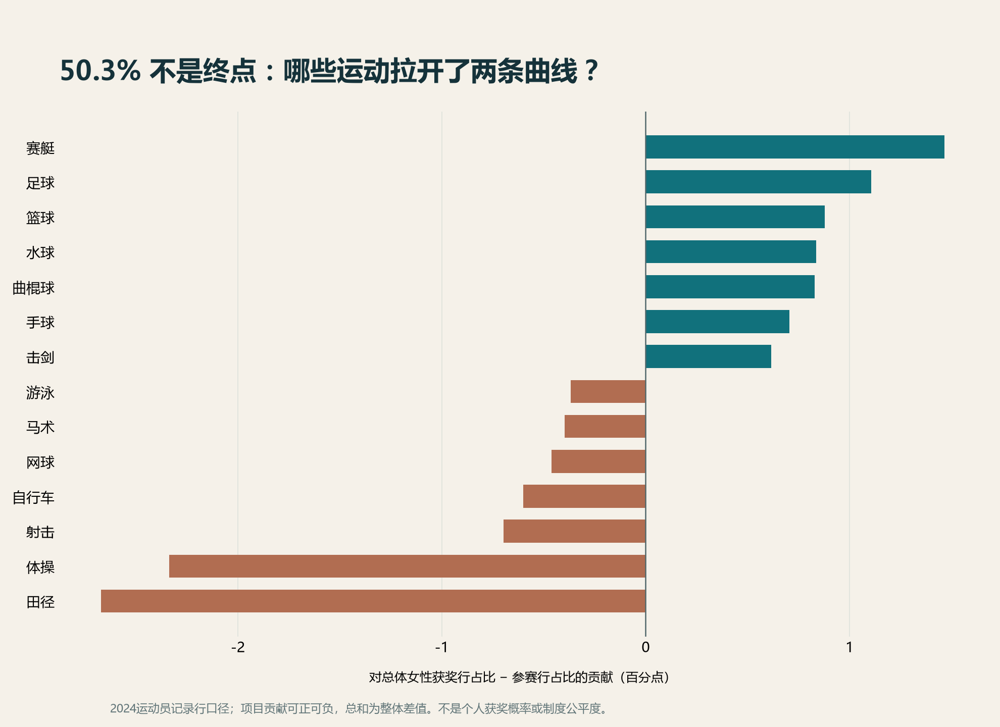

女性获奖行占比比参赛行高 1.185 个百分点。按运动家族作对称分解，项目内部结构贡献为 +1.294 个百分点，运动在两种记录中的权重差贡献为 -0.109 个百分点。田径、体操等负贡献与赛艇、足球等正贡献抵消，因此总体接近 50% 不说明各运动同质。这里比较的是**记录构成**，不是个人获奖概率或制度公平度。完整公式、逐运动数据与反例见[女性结构分解](../08_女性结构分解/女性结构分解.md)。
<!-- GENDER_DECOMP_END -->

## D. 项目演化：扩容是一条主线，更替同样重要

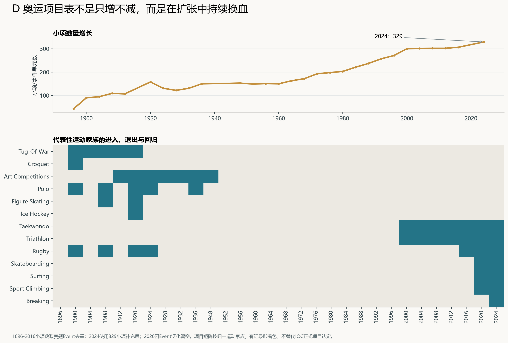

按可比口径，奥运小项从 1896 年约 43 个增至 1920 年 158 个、1984 年 221 个、2000 年 300 个，2024 年达到官方 329 个。增长并非机械累加：部分运动长期稳定，部分项目退出或重返，艺术比赛等历史项目已经消失，近年又加入更贴近城市文化与青年参与的新项目。项目表的变化说明奥运不是固定容器，而是持续在传统、全球普及度、转播价值、性别平衡与青年吸引力之间重新配置有限席位。

图中 2020 年留空不是数据缺失疏忽，而是主动的口径控制：主表自 2020 年起 Event 出现泛化，若直接按唯一值计数，会制造虚假的断崖。2024 年改用逐项核验后的官方 329 小项表，既保留了最新届次，又避免把不可比字段硬拼成趋势。这类“宁缺毋滥”的处理，是数据可视化可信度的重要组成部分。

**方法说明。** 1896—2016 年以清洗后 Event 唯一值估计小项数；2020 年因字段泛化不计；2024 年使用官方补充表。代表项目出现矩阵按体育大类归一结果聚合，表达项目是否在当届出现，不用于计算官方项目数量。

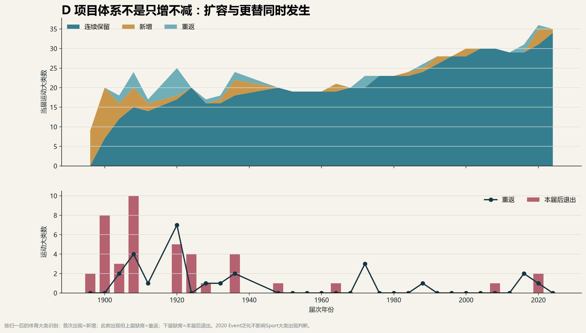

按归一体育大类识别生命周期，早期届次新增与退出较多，制度成熟后连续保留成为主体，但近年仍存在重返与更新。这里把首次出现定义为“新增”，此前出现但上届缺席定义为“重返”，当届出现而下届缺席定义为“本届后退出”。这一视角补足了总量曲线无法表达的项目流动。

## 结论：奥运的百年主线是“扩张中的去集中化”

四个视角共同指向一个更完整的叙事：奥运从少数国家、少量项目和男性主导的赛事，发展为覆盖 206 个代表团、329 个小项、女性参与接近平权的全球制度。扩张带来绝对奖牌记录通胀，却没有带来同等程度的强国垄断；强国格局在战争、抵制和政体变化中不断重组；女性人数平权已接近实现，但项目机会结构仍有差距；项目表则通过持续增删回应时代变化。评价“谁更强、是否更公平、项目是否更丰富”时，必须把绝对值、份额、历史断点和统计口径同时放进画面。

## 证据边界与复现

- “奖牌记录”是运动员行口径，不是官方小项奖牌数。
- 1906 不纳入主分析；历史 NOC 不做事后合并。
- 2020 小项数量不参与趋势；2024 使用官方补充表。
- 全部图表和中间表可由根目录的 `一键运行任务二.cmd` 重建。
- 详细数据质量规则见任务一《数据质量与口径说明书》。
