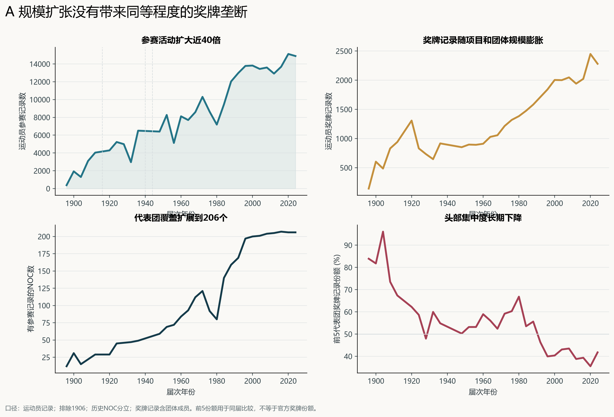
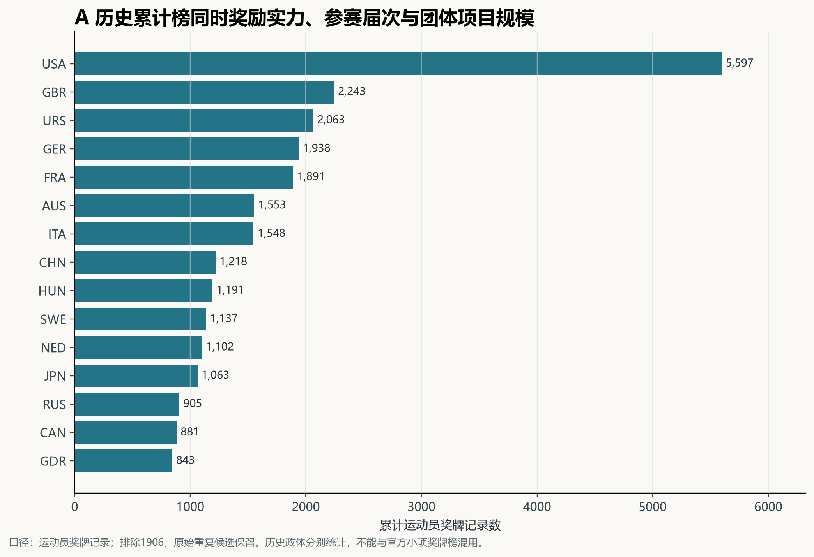

# A｜奖牌格局：规模膨胀，集中度下降

1896 年只有 380 条参赛记录、12 个代表团和 143 条运动员奖牌记录；2024 年增至 14,892 条、206 个代表团和 2,281 条。奖牌记录绝对量膨胀约 16 倍，但前五代表团在同届奖牌记录中的份额由 83.9% 降至 41.8%。因此，只看奖牌记录总数会误以为强国越来越强；改看同届份额，看到的却是奥运覆盖范围扩大后的分散化。两种读法指向不同问题，不能互相替代。早期参赛格局极窄，跨百年的绝对量比较尤其需要谨慎。

历史累计榜显示美国共有 5,597 条获奖运动员记录。这个值同时受到参赛届数、项目机会和团体人数影响，所以累计榜适合描述历史获奖记录总量，不等于官方小项奖牌榜，也不宜单独判定单届统治力。逐届榜单演变可在[交互总览](../05_交互总览/index.html)按年份切换，观察排名与集中度如何随届次变化。

**口径与复核。** 奖牌为运动员行；同一团体获奖可贡献多条记录。排除 1906；按当届实际记录计算，不把未参赛代表团补为零。数据表：[逐届规模与集中度](../02_数据表/A_逐届规模与集中度.csv)。
