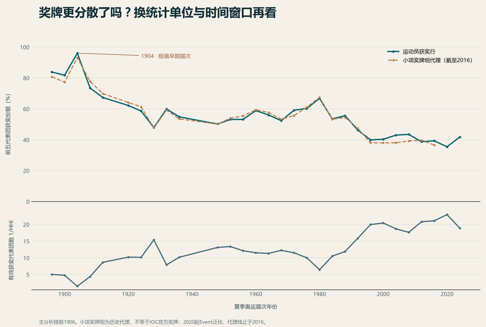

# 结论压力测试｜奖牌更分散了吗？

**晓组织 · 任务二补充研究。** 主报告提出“扩张中的去集中化”：前五代表团获奖运动员行份额由 1896 年 83.9% 降至 2024 年 41.8%。这条长期叙事需要经得起统计单位、重复候选和观察窗口的检验。

## 发现一：长期方向存在，但不是每届都下降

早期（1896—1936）前五份额的届次中位数为 **64.8%**，1992—2024 为 **40.4%**。1904 年的 96.1% 是极端早期届次，不能让单个起点代替整个早期。改用各届中位数之后，长期下降仍然成立。

**反直觉的最近一段：**2016 年前五份额为 39.3%，2024 年回升到 41.8%；按 HHI 换算的“有效获奖代表团数”同期从 21.1 降至 18.9，尽管实际获得奖牌记录的代表团数从 86 增至 92。这说明“获奖代表团更多”与“奖牌分布更均匀”并非同一命题。本页不把两届波动推断成长期逆转。

## 发现二：团队成员行不是唯一解释

把 2016 年及以前的记录按“届次 × 代表团 × Sport × Event × Medal”合为一个奖牌组代理后，早期前五份额中位数为 **67.0%**，1992—2016 为 **38.1%**。长期方向在这一替代单位下仍出现。2016 年运动员行口径的前五份额为 39.3%，代理口径为 36.6%，具体水平并不相同。

这个代理**不是 IOC 官方小项奖牌表**：历史同名 Event、并列奖牌与记录缺口都可能影响组数。2020 起 Event 泛化，故代理线停在 2016；2024 只显示可审计的运动员行，不把泛化 Event 硬接到历史代理曲线。

## 发现三：重复候选处理不改变 2024 主结论

主分析保留任务一标记的重复候选；仅删除“重复余量”后的 2024 前五份额为 **41.8%**，与保留时的 41.8% 相差 **0.018 个百分点**。这只检验一项数据清洗决定，不能替代对所有源数据误差的评估。

## 机制、边界与复现

赛事扩容使更多代表团获得参赛和获奖机会；但项目组合、团队人数、主办与抵制背景会同时改变分配。因此本图支持“长期竞争格局更分散”的描述，却**不识别去集中化的单一因果机制**。HHI 为各代表团份额平方和，有效获奖代表团数为 `1/HHI`；它反映分配均匀度，与简单的获奖代表团数不同。

运行 `项目工作区/scripts/concentration_stress_test.py` 复算。输入为任务一归一表 `项目工作区/outputs/olympics_flagged.csv.gz`；完整逐届结果见 [逐届集中度三口径.csv](逐届集中度三口径.csv)，摘要见 [结论压力测试摘要.json](结论压力测试摘要.json)。主分析排除 1906，历史 NOC 不做政体合并，奖牌为运动员获奖行。图和报告可作为任务二正式报告 A 节的稳健性补充。
