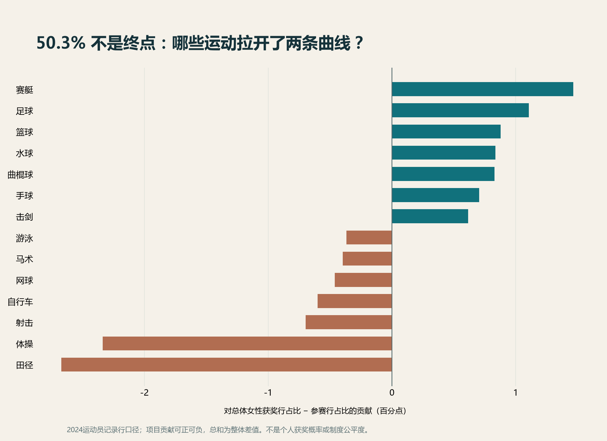

# 2024 女性获奖占比：1.18 个百分点来自哪里？

**任务二 C 与任务三 S8 交叉研究。** 2024 年女性参赛记录占 49.10%，女性获奖记录占 50.28%，相差 **+1.185 个百分点**。两者都按运动员记录行统计；参赛行 14,892 条、获奖行 2,281 条。

## 一个更具体的问题

“超过 50%”可以由两种因素共同形成：不同运动在参赛与获奖记录中的权重变化，以及同一运动家族内部女性记录份额的变化。用对称分解把总差值写为两部分：**项目内部结构 +1.294 个百分点**，**运动权重差 -0.109 个百分点**，两项合计 +1.185 个百分点。这里的“内部结构”仍是记录构成差，不是女性运动员的个人夺牌概率。

2024 年贡献较正的运动包括 赛艇（+1.46）、足球（+1.11）、篮球（+0.88） 个百分点；较负的包括 田径（-2.67）、体操（-2.34）、射击（-0.70） 个百分点。正负项相互抵消，最后只留下 +1.185 个百分点。因此总比例接近 50%，不能说明各运动内部都接近平衡。

## 分解公式与处理

对运动家族 s，令 `P_s` 为该家族占全部参赛行的权重，`M_s` 为占全部获奖行的权重；`p_s` 与 `m_s` 分别是该家族参赛行、获奖行中的女性份额。则总差值为 `Σ(M_s m_s − P_s p_s)`，对称分解为 `Σ[(m_s−p_s)(M_s+P_s)/2] + Σ[(M_s−P_s)(m_s+p_s)/2]`。两部分精确相加回到总差值。无获奖行的家族令 `m_s=p_s`，其项目内部贡献为 0，避免给不可观察的局部比例赋予含义。

## 反例与证据边界

田径的负贡献与赛艇的正贡献都较大，说明整体 50.3% 是异质项目抵消后的结果。团队项目一个获奖小项会产生多条运动员行；项目配额和参赛记录也不是独立运动员。因此本分解不能支持“女性个体更容易夺牌”“某运动制度更公平”或因果解释。若要评价正式机会，应并列研究官方女子、男子、混合小项数和参赛名额。

运行 `项目工作区/scripts/gender_gap_decomposition.py` 复算。输入为任务一归一表中的 2024 届次；[逐运动家族结果](2024女性占比分解逐项目.csv)和[摘要 JSON](女性结构分解摘要.json)随本页交付。主分析排除 1906，2024 Sport 已按任务一运动家族归一。
