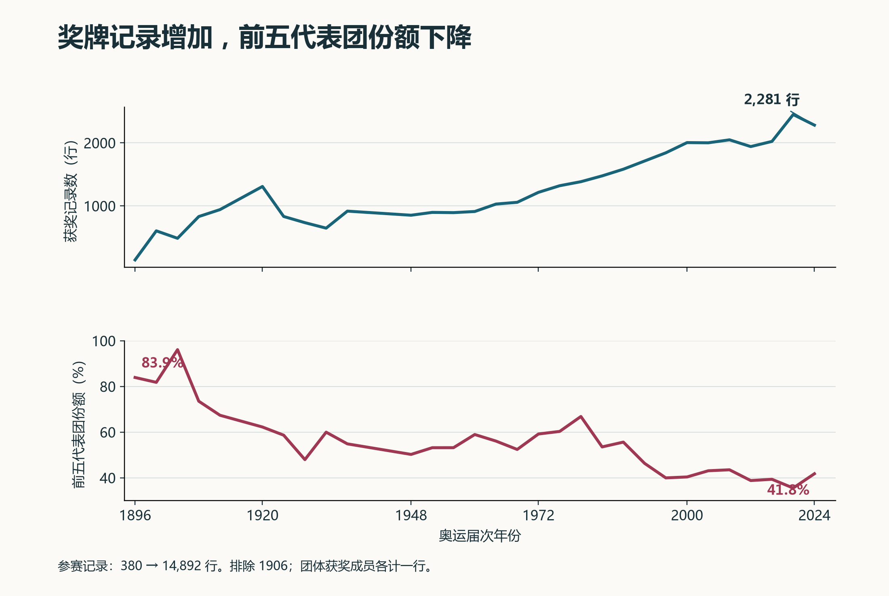
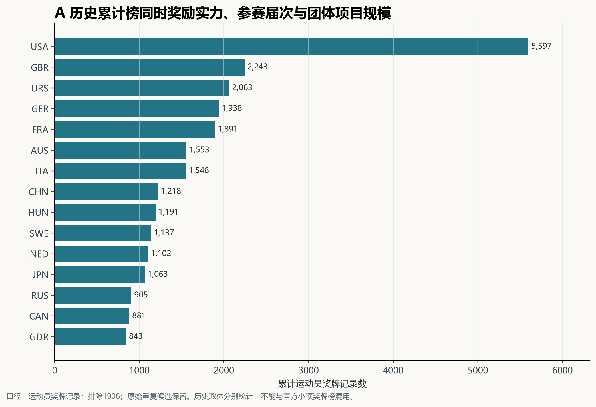
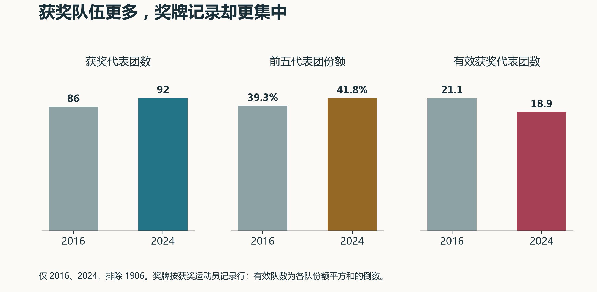

# A｜奖牌格局：规模膨胀，集中度下降

1896 年只有 380 条参赛记录、12 个代表团和 143 条运动员奖牌记录；2024 年增至 14,892 条、206 个代表团和 2,281 条。奖牌记录绝对量膨胀约 16 倍，但前五代表团在同届奖牌记录中的份额由 83.9% 降至 41.8%。因此，只看奖牌记录总数会误以为强国越来越强；改看同届份额，看到的却是奥运覆盖范围扩大后的分散化。两种读法指向不同问题，不能互相替代。早期参赛格局极窄，跨百年的绝对量比较尤其需要谨慎。

历史累计榜显示美国共有 5,597 条获奖运动员记录。这个值同时受到参赛届数、项目机会和团体人数影响，所以累计榜适合描述历史获奖记录总量，不等于官方小项奖牌榜，也不宜单独判定单届统治力。逐届榜单演变可在[交互总览](../05_交互总览/index.html)按年份切换，观察排名与集中度如何随届次变化。

**口径与复核。** 奖牌为运动员行；同一团体获奖可贡献多条记录。排除 1906；按当届实际记录计算，不把未参赛代表团补为零。数据表：[逐届规模与集中度](../02_数据表/A_逐届规模与集中度.csv)。

[逐届联动对照](../05_交互总览/index.html#panorama-lead)可同步比较获奖代表团数、前五份额和有效获奖代表团数，选队后查看运动构成。

逐届对照可固定一届为基准，读取两届指标和增减量。复制分析链接可恢复所选届次和代表团，CSV 包含两届指标及当前代表团运动构成。

<!-- core-case-A:start -->
## 获奖队伍更多，奖牌记录却更集中

里约到巴黎，获奖代表团由 86 个增至 92 个，但前五代表团的记录份额也由 39.3% 升至 41.8%。同一时期，有效获奖代表团数从 21.1 降至 18.9。

三组对照使用各自单位，读数应在同一组内比较。获奖队数每队计一次，前五份额关注头部，有效队数则以全场份额分布为基础，对大份额代表团更敏感。

三项合读能区分获奖覆盖和分布均匀度。这个反例只对应里约与巴黎，不能用两个端点判定百年趋势已经逆转。团体奖牌在运动员行口径下仍可能对应多条记录。

**口径。** 仅 2016、2024，排除 1906。奖牌按获奖运动员记录行；有效队数为各队份额平方和的倒数。
<!-- core-case-A:end -->

<!-- sport-mix:start -->
2016 到 2024，前五份额实际增加 2.43 个百分点；固定 31 类共同运动权重后仍增加 2.44 个百分点。 固定 2016 年标准化榜前五队（USA、GER、GBR、RUS、CHN）时，同一组队伍的合计份额从 39.20% 降至 33.11%。 [查看图表和复算表](../12_固定运动构成/固定运动构成复核.html)。
<!-- sport-mix:end -->
