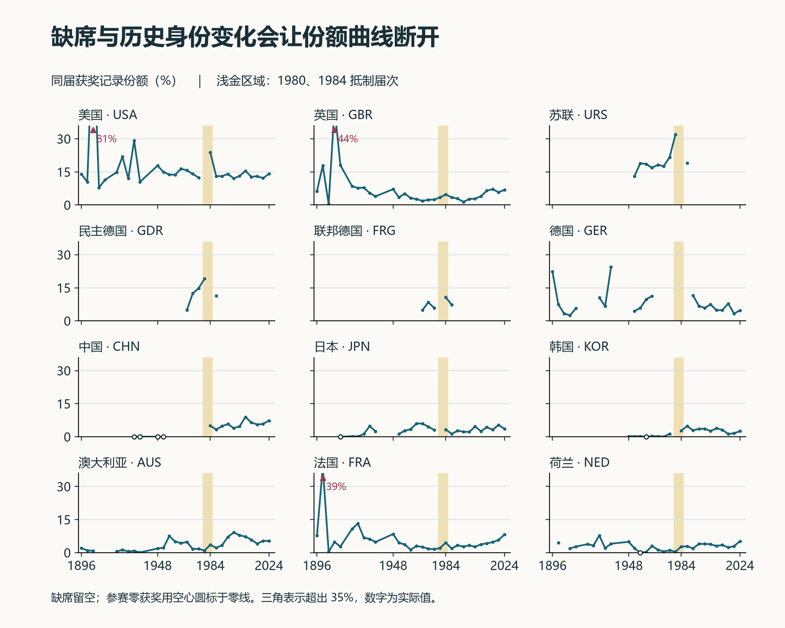
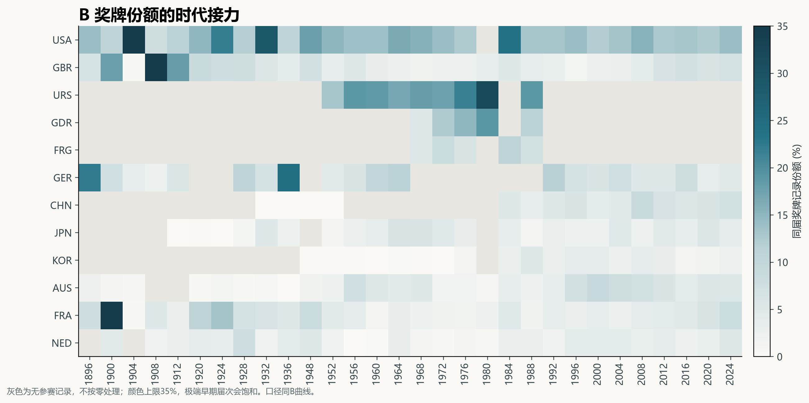
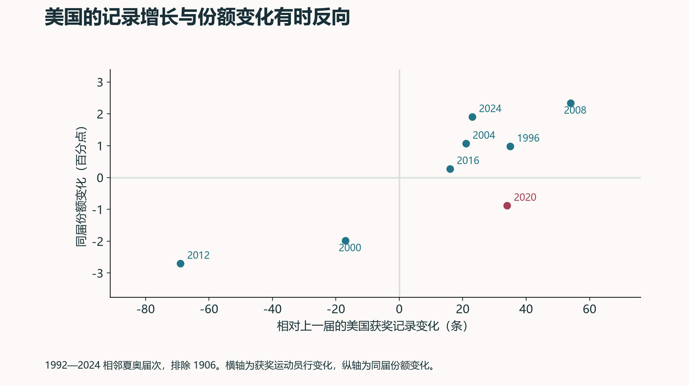

# B｜国家兴衰：断点比平滑趋势更重要

十二个代表团的逐届奖牌记录份额展示了至少八个具有不同轨迹的国家与地区。美国的长期优势并非固定占比：1904 年的 81% 是早期特殊参赛格局下的极端值，战后多数届次约为 12%—16%。苏联从 1952 年起迅速进入高份额区间，1988 年之后的身份转变使曲线自然中断。东德、西德和统一后的德国分别呈现，避免把不同政体当作同一个连续主体。中国自 1984 年形成连续轨迹，2008 年约占 9.0%，2024 年约占 7.4%。日本、韩国等代表团的进阶也可在图中与同届整体规模同步观察。

**案例｜美国获奖记录增加，同届份额却下降。** 里约 2016 到东京 2020 年，美国从 264 条增至 298 条，同届份额从 13.05% 降至 12.17%。美国获奖运动员记录增长 12.9%，但当届全部代表团的获奖记录从 2,023 条增至 2,449 条，增幅为 21.1%。分母增长更快，因此美国的同届份额下降 0.88 个百分点。按运动员获奖记录行统计，排除 1906。东京按届次记为 2020 年。

热力图中的空白表示没有参赛记录，不能解释成零奖牌。1980 与 1984 年抵制潮、主场届和历史政体变化，都会扰动表面排名。作为机制核查，本报告还对主场效应进行了[扩展合成对照与稳健性分析](../04_核心图表/B_20届合成对照与稳健性.png)：高拟合 14 案例平均差为 +2.24 个百分点，但主办权选择仍限制因果解释。

**口径与复核。** 指标为当届某代表团获奖运动员记录数除以当届全部获奖运动员记录数；历史代码分别保留，1906 排除。数据表：[十二代表团逐届份额](../02_数据表/B_十二代表团逐届份额.csv)。

[双指标曲线](../05_交互总览/index.html#team-share-case)可切换十二个历史代表团，标记相邻届获奖记录数与同届份额反向变化的位置。

双指标曲线支持复制选队链接，CSV 同时提供逐届分母、份额和参赛状态。

<!-- core-case-B:start -->
## 美国的记录增长与份额变化有时反向

每个点代表美国从上一届到所标届次的变化。多数点落在两个同向象限，说明记录数与份额常常一起升降；里约到东京落在右下，表示获奖记录增加而份额减少。

右下角案例增加 34 条获奖记录，份额却下降约 0.88 个百分点。同期全场总量从 2,023 行增至 2,449 行，增长比美国更快。横轴看绝对规模，纵轴看相对位置。

这张图只观察美国及给定的现代时间窗口。其他代表团的缺席和零获奖应分开处理；本图中的记录数也不能直接读成官方小项奖牌数。

**口径。** 1992—2024 相邻夏奥届次，排除 1906。横轴为获奖运动员行变化，纵轴为同届份额变化。
<!-- core-case-B:end -->
