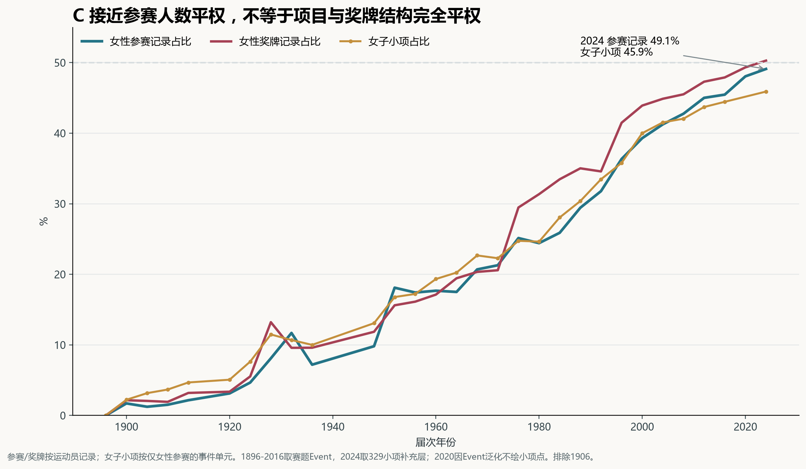
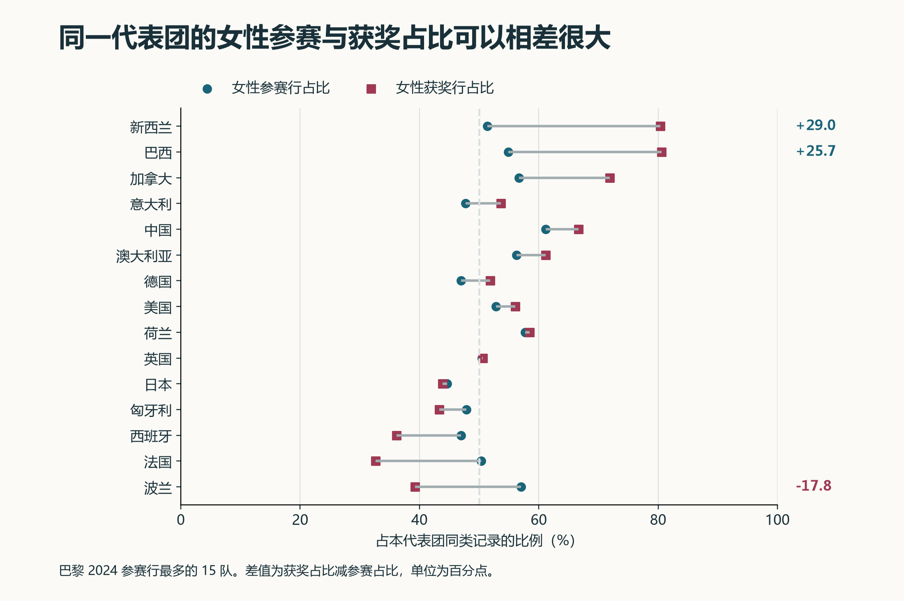

# C｜她的奥运：参赛与获奖记录接近半数，小项结构仍有差异

### 巴黎 2024 的三个分母

| 指标 | 分子 / 分母 | 占比 |
| --- | ---: | ---: |
| 女性参赛记录占比 | 7,312 / 14,892 | 49.1% |
| 女性获奖记录占比 | 1,147 / 2,281 | 50.3% |
| 女子专属小项占比 | 151 / 329 | 45.9% |

百年趋势显示，女性逐步从早期缺席走向接近半数的参赛规模。2024 年女性参赛记录占 49.1%，女性奖牌记录占 50.3%，而官方 329 个小项中的女子专属小项为 151 个，占 45.9%。这三个比例测量的是不同层次：参赛机会、获奖记录和赛程设置。女性奖牌记录超过一半，并不表示每一类项目都已经实现完全对称；团体项目人数、混合小项和项目组合都会改变统计结果。用三条线同时表达，能避免把一个接近 50% 的数字误当作全部答案。

代表团内部也有反例：在获奖记录较多的代表团中，新西兰女性获奖记录占比比女性参赛记录占比高约 29.0 个百分点，巴西高约 25.7 个百分点；法国和波兰则分别低约 17.7 个百分点。这些差值更适合作为项目组合差异的提示，不应直接解释为国家制度优劣。

**口径与复核。** 历史参与和获奖按原始 Sex 字段对应的运动员记录计算；2024 小项属性使用任务一官方 329 项表，女子专属、男子专属和混合小项分列。数据表：[女性参与获奖与小项](../02_数据表/C_女性参与获奖与小项.csv)、[2024代表团女性结构](../02_数据表/C_2024代表团女性结构.csv)。

[巴黎代表团运动贡献](../05_交互总览/index.html#panorama-gender)可切换有获奖记录的代表团，查看本队参赛与获奖分母及各运动对女性份额差的贡献。

两队可按统一尺度并排比较运动贡献。CSV 逐队列明分子、分母和各运动贡献，复制链接可恢复两队的选择。
