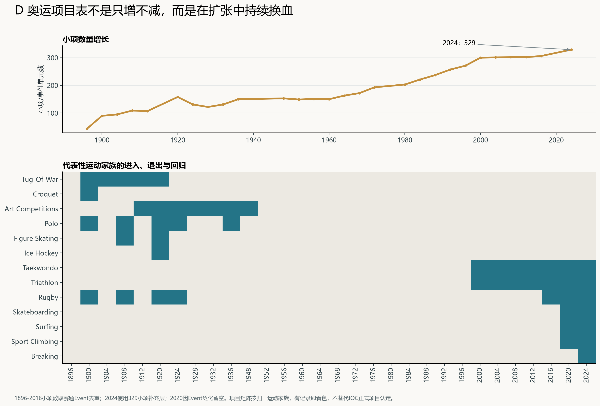
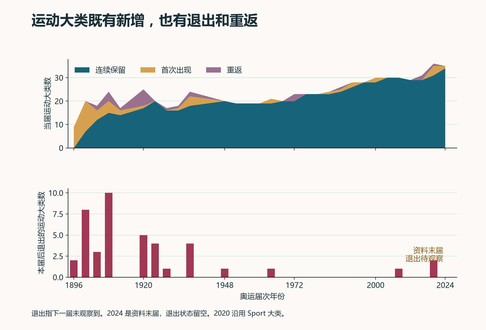

# D｜项目演化：扩容、退出与重返

按可比的清洗后 Event 唯一值估计，1896 年约 43 个小项，1920 年约 158 个，1984 年约 221 个，2000 年约 300 个；2024 年使用官方补充表，确认为 329 个。这里没有把 2020 年的原始 Event 值硬接进趋势，因为该字段从该届起出现泛化，会造成虚假的小项数量断崖。增长曲线也不是只增不减：拔河、槌球、马球和艺术竞赛留下历史痕迹；跆拳道、七人制橄榄球、滑板、冲浪和霹雳舞体现近年项目更新。花样滑冰曾出现在 1908、1920 年夏季奥运会，冰球也曾出现在 1920 年夏季奥运会，提醒我们不要用今天的“夏季／冬季”划分倒推早期赛程。

项目生命周期图将首次出现、上届缺席后重返和本届之后退出分开显示。它补足了总量曲线的盲点：即使总小项数变化很小，项目组合仍可能明显更替。图中的“退出”是基于所用数据在下一届未出现的操作性定义，不等于国际奥委会永久取消该运动。

**口径与复核。** 1896—2016 年是 Event 字段的历史估计值，2020 年留空，2024 年取官方 329 项；体育大类按任务一归一映射。数据表：[逐届小项数量](../02_数据表/D_逐届小项数量.csv)、[代表项目出现矩阵](../02_数据表/D_代表项目出现矩阵.csv)、[新增退出重返](../02_数据表/D_项目新增退出重返.csv)。

### 相邻届次对照 · 1900 与 1904

项目星系的「对照 1900 与 1904」会切换到 1904 并展开名单。按赛题归一数据，运动大类 20 → 18，净减 2 类，但 4 类首次出现、2 类重返、8 类未再出现，合计更替 14 类。比较基于运动大类在相邻已收录届次是否有参赛记录，排除 1906。
