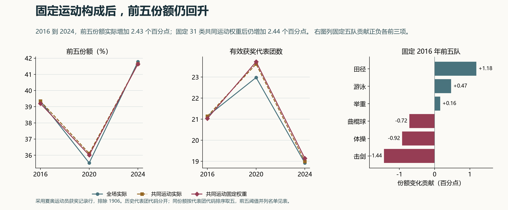

# 固定运动构成后，前五份额仍回升吗？

2016 到 2024，前五份额实际增加 2.43 个百分点；固定 31 类共同运动权重后仍增加 2.44 个百分点。 东京 2020 在三种口径下都处于这三届的低位。固定权重后，有效获奖代表团数从 21.03 降至 19.14。

## 运动内份额与运动权重

三届均有获奖行的 31 类运动进入共同集合。共同运动实际值沿用各届自己的记录权重。固定权重取三届共同运动合并后的记录构成，再乘各届各运动内每个代表团的份额并加总。每种口径按份额重新排前五。有效获奖代表团数为各队份额平方和的倒数。

在共同运动实际口径下，前五份额增加 2.30 个百分点。将 2016 与 2024 的运动权重和运动内份额逐一替换，并平均两种替换顺序，运动内份额贡献 +2.33 个百分点，运动权重贡献 -0.03 个百分点。每个替换情景都重新排名；这两个贡献严格加总为共同运动实际变化。

改用 2016 运动权重、2024 运动权重或运动等权，连同三届合并权重，2016 到 2024 的前五份额变化落在 +0.92 至 +2.49 个百分点之间。四种固定权重方案下方向一致。

## 同一组队伍怎样变化

固定 2016 年标准化榜前五队（USA、GER、GBR、RUS、CHN）时，同一组队伍的合计份额从 39.20% 降至 33.11%。 这组固定队伍的正贡献主要来自田径（+1.18 个百分点），负贡献主要来自击剑（-1.44）、体操（-0.92）。逐运动贡献使用统一运动权重，合计等于固定五队的份额变化。此处的固定队伍结果与每届重新选出的前五回答两个问题。2024 固定权重重新排名的前五为 USA、FRA、CHN、GBR、NED。

## 口径与复算

采用夏奥运动员获奖记录行，排除 1906。历史代表团代码分开；同份额按代表团代码排序取五，前五阈值并列名单见表。 RUS、ROC 等历史代码分别计量，固定五队的降幅包含 RUS 的标准化份额从 5.63% 至 0.00% 的变化；若仅比较同组另外四队，其合计份额变化为 -0.46 个百分点。结论只适用于这三届和所定义的共同运动；标准化是描述性比较，无法识别因果效应。

复算入口为 `项目工作区/scripts/task2_sport_mix.py`，输入是任务一交付的归一数据（保留原始字段）。

[三口径集中度](三口径集中度.csv) · [逐队份额](逐队份额.csv) · [运动权重与贡献](逐运动权重与固定五队贡献.csv) · [变化分解](共同运动变化分解.csv) · [固定权重敏感性](固定权重敏感性.csv)
